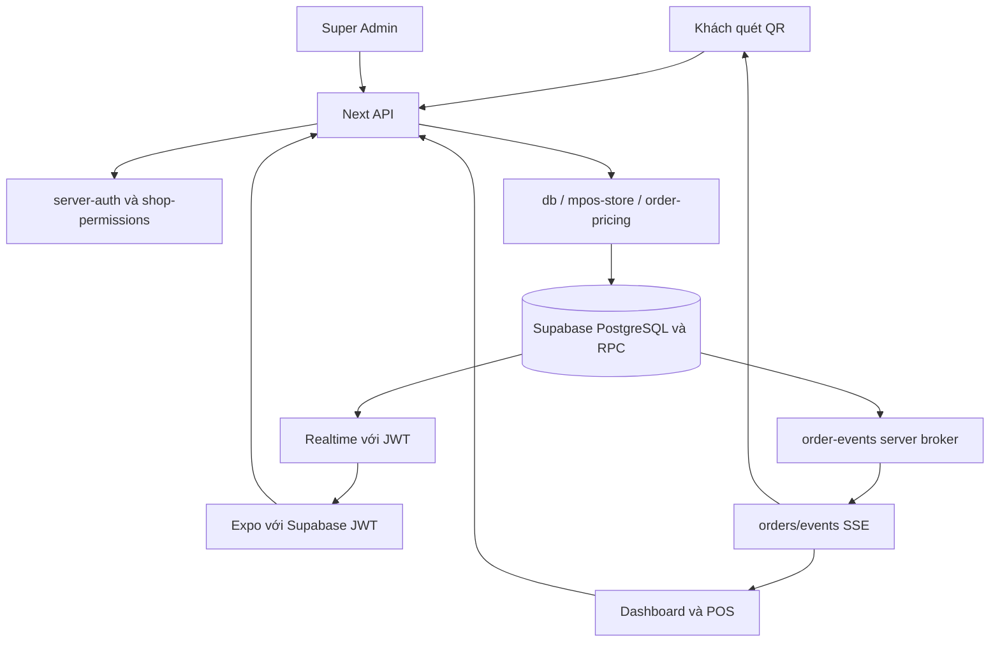

# Kiến trúc Qlaok

Đối chiếu source trong workspace ngày **24/10/2026** qua CodeGraph. Không khẳng định trạng thái production. Bắt đầu với [README](README.md) và [quy trình CodeGraph bắt buộc](docs/CODEGRAPH_WORKFLOW.md).

## Các ứng dụng và công nghệ

| Phần | Vị trí | Trách nhiệm |
| --- | --- | --- |
| Web Next.js 15 / React 19 / TypeScript | `src/app`, `src/components` | Marketing, auth, merchant dashboard, storefront, Super Admin |
| Backend App Router | `src/app/api` | Xác thực, quyền, catalog, đơn, pricing, thanh toán, AI, upload |
| Mobile Expo SDK 52 / React 18 / RN 0.76 | `mobile/App.tsx`, `mobile/src` | Đăng nhập kép Chủ quán (Supabase JWT) & Nhân viên (`staff-session` / `staff-api`), chọn shop cho chủ quán và gọi món hộ tại bàn cố định theo quán (`StaffWorkspace` + `AssistedOrderScreen`) |
| Supabase | `supabase/migrations` | PostgreSQL, Auth, RLS, RPC atomic, Realtime |
| Tích hợp | `src/lib/gemini.ts`, `src/lib/r2.ts`, `src/lib/garage-storage.ts` | Gateway AI text/vision, OCR; ảnh dùng Garage object storage `qlaok-media`, R2 chỉ là fallback |
| Kiểm tra/triển khai | `tests`, `mobile/tests`, `.github/workflows`, `scripts` | Regression cô lập, fixtures, migration và deploy |

Các version trên là dòng dependency trong manifest, không phải khẳng định patch đang chạy trên VPS. Web và mobile có dependency tree/lockfile riêng; không dùng provider React web cho mobile.

## Bản đồ route

| Route | Phần triển khai/chức năng |
| --- | --- |
| `/`, `/pricing`, `/explore` | Marketing, plan copy và danh bạ |
| `/login`, `/onboarding` | Auth và tạo shop |
| `/s/[slug]`, `/s/[slug]/menu` | QR Cửa, QR Bàn và menu theo ngành |
| `/dashboard` | Tổng quan doanh thu và tồn kho |
| `/dashboard/orders` | POS, đơn, thanh toán và in |
| `/dashboard/kitchen` | Màn hình bếp (KDS): hàng đợi đơn đang làm (`new`, `preparing`), ưu tiên đơn cũ nhất trước, cảnh báo quá 15 phút và thao tác chạm `new → preparing → completed` |
| `/dashboard/catalog`, `/posts`, `/settings` | Nội dung và cấu hình shop |
| `/dashboard/reports`, `/billing` | Báo cáo và gói SaaS |
| `/dashboard/ai-scanner`, `/qr-studio` | OCR/import, xuất QR và sơ đồ bàn (floor plan) |
| `/admin` | Quản trị toàn hệ thống |

Các đường `/posts`, `/settings` trong bảng là hậu tố của `/dashboard`, không phải route root.

API hiện có: `/api/auth`, `/auth/login-ui`, `/auth/callback`, `/admin`, `/shops`, `/tables`, `/tables/floor-plan`, `/catalog`, `/posts`, `/orders`, `/orders/events`, `/service-requests`, `/push-tokens`, `/analytics/track`, `/ai/translate`, `/ai/ocr-menu`, `/upload`, `/webhooks/payment`, `/webhooks/sepay/[shopId]`, `/health` (các hậu tố sau mục đầu đều dưới `/api`). Không có `/api/items`; tài liệu cũ từng liệt kê route này sai với cây source hiện tại.

`GET /api/catalog` phục vụ public storefront và trả catalog projection gồm `shop`, `categories`, `items`, `ownerPlan`; không serialize `profile`. Các helper nội bộ có thể giữ dữ liệu profile cho legacy callers, nhưng dữ liệu đó không thuộc public response.

`GET /api/tables/floor-plan` yêu cầu xác thực phiên đăng nhập và quyền `orders.view` theo `shopId`, phân trang DB an toàn theo từng trang 500 dòng (giới hạn trần tối đa 10.000 bản ghi), tính toán tổng hợp từ danh sách bàn và đơn hàng để trả về danh sách bàn kèm trạng thái vận hành phía server (`floor_status`: `inactive`, `free`, `occupied`, `waiting_payment`), số đơn đang mở (`open_order_count`) và tổng tiền chưa thanh toán (`unpaid_amount`). Cập nhật vị trí sơ đồ bàn tái sử dụng contract `PATCH /api/tables` (yêu cầu quyền owner hoặc admin của quán), xác thực và lưu tọa độ phần trăm nguyên `layout_x`, `layout_y` trong khoảng `[0, 100]` (hoặc `null`).

`/api/ai/translate` và `/api/ai/ocr-menu` yêu cầu phiên đăng nhập (`requireAuthenticatedUser`) và giới hạn tần suất in-memory theo user (translate 30 req/10 phút, OCR 10 req/10 phút → 429). OCR thật (không phải `useDemo`) đi qua `requireAiOcrPlan` (`src/app/api/ai/_lib/guard.ts`): xác định chủ sở hữu của quán đang chọn mà caller có quyền truy cập, kiểm tra gói của chủ quán có `allowAiOcr` (Premium, hoặc Super Admin; nếu không trả `403 PLAN_FEATURE_LOCKED`), đồng thời yêu cầu membership thu ngân/nhân viên phải có quyền chuẩn `catalog.manage` (`403 INSUFFICIENT_SHOP_PERMISSION`). `/api/webhooks/payment` không có secret mặc định: thiếu `PAYMENT_WEBHOOK_SECRET` thì mọi webhook từ nhà cung cấp bị từ chối (503); `action=create_order` yêu cầu chủ quán/profile owner hoặc Super Admin đã xác thực (thu ngân/nhân viên bị từ chối 403, chỉ Super Admin được chỉ định `ownerId` khác). `/api/webhooks/sepay/[shopId]` tách biệt hoàn toàn với nâng cấp gói SaaS: chỉ đối soát đơn khách (`ShopOrder`) của chính `shopId` đó bằng khóa HMAC riêng đã mã hóa AES-256-GCM tại chỗ bằng `SEPAY_SECRET_ENCRYPTION_KEY` (thiếu khóa chủ trả 503), kiểm tra chữ ký HMAC-SHA256 trên `{timestamp}.{raw_body}` (`X-SePay-Signature` + `X-SePay-Timestamp`) trước khi parse JSON, chỉ nhận tiền vào (`transferType === 'in'`) đúng tài khoản ngân hàng đã cấu hình của quán, khớp duy nhất `order_code` kèm `transferPrefix`, đúng đơn `vietqr` đang `unpaid` chưa hủy và đúng số tiền VND tuyệt đối, ghi sổ sự kiện idempotent (`public.sepay_webhook_events`) và chỉ cập nhật trạng thái thanh toán mà không chạm tới trạng thái phục vụ/bếp (`status`) hay tồn kho.

## Bảng dữ liệu và file báo cáo

Bảng dữ liệu web dùng `react-data-table-component` qua `src/components/ui/AppDataTable.tsx`; React Native không dùng thư viện React DOM này. CSV và workbook XLSX được tạo ở `src/lib/table-export.ts`, XLSX dùng ExcelJS tải theo nhu cầu. UI và export báo cáo dùng cùng dữ liệu đã lọc/sắp xếp, phân biệt phạm vi toàn bộ kết quả và trang hiện tại. Chart hiện tại vẫn là SVG/CSS tự vẽ (web) và View/Text (mobile). Xem [quy ước bảng/export](docs/DATA_TABLES_AND_EXPORT.md).

## Contracts và tầng core

| Module | Nhiệm vụ và lưu ý |
| --- | --- |
| `src/types/qlaok.ts` | Contracts locale, catalog, đơn, membership, shop theme, payment |
| `src/app/(dashboard)/dashboard/catalog/page.tsx`, `src/components/dashboard/QuickItemRow.tsx` | Catalog dạng danh sách hàng ngang, chọn món theo dòng/trang và giữ lựa chọn qua phân trang; thanh thao tác hàng loạt chỉ chạy trên các ID đang chọn, đồng bộ sau phản hồi server |
| `src/app/api/catalog/route.ts` | API catalog; thao tác hàng loạt giá/tồn kho, chuyển danh mục, xóa và `bulk_update_availability` đều xác thực quyền cùng shop. Bulk availability chỉ cập nhật `is_available`, yêu cầu `catalog.manage` hoặc `inventory.adjust`, kiểm tra toàn bộ ID thuộc shop và xác nhận số dòng ảnh hưởng |
| `src/app/(dashboard)/dashboard/settings/page.tsx` | Settings quán chia thành năm tab (thông tin quán, giao diện, thanh toán, đơn hàng & in ấn, nhân viên); các deep link cũ tự chọn tab tương ứng và giữ nguyên editor trong cùng trang |
| `src/lib/db.ts` | Supabase client, CRUD shop/catalog/posts, bảo lưu bí danh slug (`public.shop_slug_aliases`, migration `014_shop_slug_aliases.sql`) khi đổi slug qua Settings hoặc Super Admin (`dbUpdateShop`) kèm chống đụng độ chéo quán và phân giải ưu tiên canonical trước alias (`dbGetStorefrontBundle`), analytics, billing và seed (chỉ tự seed dữ liệu demo ở môi trường non-production; trên `NODE_ENV=production` khi `public.shops` rỗng trả `{ ready: true, seeded: false }` mà không tự ghi demo shop) |
| `src/lib/mpos-store.ts` | Orders, stock, giá canonical, transition, bill theo bàn/session, hàng đợi bếp đang hoạt động (`dbGetShopActiveKitchenOrders`), phân giải bước workflow khi tạo/sửa đơn và 4 bộ đếm in độc lập |
| `src/lib/order-workflow.ts` | Quản lý quy trình phục vụ đơn hàng (templates `classic_kitchen`, `counter_bar_serve`, `simple_counter`, `custom`), kiểm tra tính hợp lệ graph (DAG, reachability, non-regressive stages), phân giải bước hiện tại/kế tiếp, nhãn khách và chuyển trạng thái bảo toàn tính độc lập với thanh toán |
| `src/lib/label-print-config.ts` | Cấu hình in tem nhãn (`ShopLabelPrintConfig`), khổ giấy (`cup_sticker_50x30`, `cup_sticker_40x30`, `production_slip_58mm`, `production_slip_80mm`), chế độ tách tem (`per_item_unit`, `per_line_item`, `single_ticket`), giới hạn số bản in/tối đa mỗi lần và bảo vệ trường nhạy cảm |
| `src/lib/production-label-print.ts`, `production-label-template.ts` | Sinh lô tem in (`buildProductionLabelBatch`), dựng HTML tài liệu in tất định (`renderProductionLabelDocument`), định dạng thời gian UTC+7, kiểm soát bản in lại (`isReprint`), và bảo vệ chỉ hiện QR thanh toán khi đơn `unpaid` |
| `src/lib/shop-tables.ts` | Store bàn, kiểm tra bàn cùng quán/đang hoạt động, owner mutation (gồm lưu tọa độ sơ đồ `layout_x`, `layout_y` [0, 100]) và public DTO |
| `src/lib/table-floor-plan.ts` | Tổng hợp trạng thái vận hành bàn (`free`, `occupied`, `waiting_payment`, `inactive`), đếm đơn mở và số tiền chưa thanh toán theo đơn hàng |
| `src/components/ShopTableFloorPlanCanvas.tsx` | Canvas sơ đồ bàn trực quan: kéo-thả, phím mũi tên (bước nhảy 2%), bounds an toàn giữ mép trên desktop (≥ 1200x680) và co an toàn theo lề 80px ngang, 64px dọc trên kích thước khác, fallback grid |
| `src/lib/service-requests.ts` | Yêu cầu phục vụ tại bàn (`call_staff`, `request_bill`) xác thực chữ ký QR bàn, chống spam lặp theo bàn/loại và chuyển trạng thái `pending → acknowledged → resolved` |
| `src/lib/table-helpers.ts` | Helper client-safe: URL QR, chuẩn hóa URL chuyển hướng canonical (`resolveStorefrontCanonicalRedirect`) giữ nguyên toàn bộ query params (`src`, `tableId`, `sig`, `table`, `lang`), resolve lựa chọn/chữ ký bàn (`createScopedTableQrVerification`, `resolveScopedTableQrVerification`), lọc bàn và thống kê theo ID |
| `src/lib/order-pricing.ts` | Công thức pricing dùng chung; không nhận tổng client làm nguồn quyết định |
| `src/lib/server-auth.ts` | Kiểm phiên HMAC (`qlaok_session`), xác thực Zitadel JWT (JWKS signature, `iss`, `aud`, `exp`, ánh xạ `sub` qua `profiles.zitadel_sub`) hoặc PostgREST authenticated JWT (`issuePostgrestAuthenticatedJwt` / `verifyPostgrestAuthenticatedJwt`, `role: 'authenticated'`), auth guards, kiểm quyền shop và admin |
| `src/lib/zitadel-oidc.ts`, `src/lib/zitadel-login-ui.ts`, `src/app/api/auth/login-ui/route.ts`, `src/app/api/auth/callback/route.ts`, `src/app/api/auth/route.ts` | Luồng xác thực, tự đăng ký & đặt lại mật khẩu Zitadel OIDC (Authorization Code + PKCE `S256`) cho chủ quán và Super Admin trên web (`https://auth.vunph.click`, callback `https://qlaok.vunph.click/api/auth/callback`) và mobile (`qlaok://auth/callback`, `POST /api/auth` `action: 'oidc_mobile_exchange'`): tạo/kiểm tra `state`, `nonce`, `code_verifier`, tự đăng ký qua `POST /v2/users/new` với mật khẩu tạm CSPRNG và chỉ đặt mật khẩu người dùng (`PATCH /v2/users/{id}`) sau khi xác thực OTP email (`POST /v2/users/{id}/email/verify`), đặt lại mật khẩu phía máy chủ qua `POST /api/auth/login-ui` (`password_reset_request` tra cứu chính xác email đã xác thực qua `POST /v2/users` và gửi link mẫu Qlaok `https://qlaok.vunph.click/login?mode=reset&userID={{.UserID}}&code={{.Code}}&orgID={{.OrgID}}` qua `POST /v2/users/{id}/password_reset` không làm lộ sự tồn tại tài khoản; `password_reset_complete` kiểm tra `userID`, `code`, chính sách mật khẩu mạnh và hoàn tất qua `POST /v2/users/{id}/password` kèm `verificationCode` và `changeRequired: false`), giới hạn tần suất bền vững qua PostgreSQL RPC theo `X-Real-IP` + khóa vé/user/email băm SHA-256, đổi mã tại token endpoint, xác minh chữ ký JWT qua OIDC discovery/JWKS, bắt buộc `email_verified === true` (kèm fallback UserInfo) trước khi tạo hồ sơ mới hoặc bổ sung email, ánh xạ `sub` qua `public.profiles.zitadel_sub` và khởi tạo hồ sơ mới an toàn (`plan: 'free'` chỉ khi insert) mà không ghi đè gói/thanh toán/quyền hiện có |
| `src/lib/shop-permissions.ts` | Membership và quyền theo shop; không dùng local để khôi phục quyền đã revoke |
| `src/lib/auth-session.ts`, `auth-credentials.ts`, `auth-recovery.ts` | Phiên web, kiểm tra quyền Super Admin và hỗ trợ đăng nhập nhân viên độc lập (`shop_member_credentials`) |
| `src/lib/onboarding-flow.ts` | Tạo quán nháp và bulk import danh mục/món đầu tiên; giữ lại `draftShop` đã lưu và dùng ID ổn định (`onboarding:<shopId>:first-category`, `onboarding:<shopId>:first-item`) để retry an toàn sau lỗi một phần |
| `src/lib/shop-setup-checklist.ts` | Đánh giá checklist 6 bước thiết lập quán lần đầu trên `/dashboard` (gồm bước `opening_hours` trỏ tới `/dashboard/settings#opening-hours-settings`, chỉ hoàn tất khi chủ quán tích xác nhận tường minh `opening_hours_confirmed = true` và lưu; tự hủy xác nhận khi chỉnh bất kỳ ngày/giờ/trạng thái mở-nghỉ nào) |
| `src/lib/dashboard-context.tsx` | Session, shop đang chọn và membership phía dashboard |
| `src/lib/order-events.ts` | Broker một upstream privileged subscription cho SSE đã được cấp quyền |
| `src/lib/order-live-sync.ts` | Fetch SSE, refresh, debounce, fallback và lifecycle trên web |
| `src/lib/kitchen-display.ts` | Helper KDS (`/dashboard/kitchen`, `KitchenTicketCard.tsx`): URL truy vấn riêng `GET /api/orders?shopId=...&view=kds` (lọc `new`, `preparing` ở DB trước khi phân trang `.range()`), lọc/sắp xếp theo `created_at` tăng dần, ngưỡng quá hạn từ 15 phút (`≥ 15p`), kiểm quyền `orders.fulfill`, tạo payload PATCH trạng thái không đụng trường thanh toán, cô lập scope theo shop và giữ nguyên vé đang hiển thị khi lỗi tải tạm thời |
| `src/lib/order-chime.ts` | Cấu hình và phát âm báo đơn |
| `src/lib/push-notifications.ts` | Lưu/xóa Expo push token theo user + shop (`orders.view`), gửi push VI/EN cho chủ quán và nhân sự `orders.view` khi có đơn QR khách mới (chống lặp theo replay đơn/in-memory sau khi có ticket `ok`, chỉ đếm ticket `status === 'ok'` và tự dọn token `DeviceNotRegistered`); mobile hủy token best-effort trước `signOut` cả khi đăng xuất và khi gặp HTTP 401 (không lặp 401 đệ quy, không chặn xóa phiên local nếu token đã hết hạn) |
| `src/lib/payment-qr.ts` | Cấu hình/URL QR thanh toán merchant |
| `src/lib/sepay-reconciliation.ts` | Mã hóa AES-256-GCM khóa HMAC SePay theo từng shop (`SEPAY_SECRET_ENCRYPTION_KEY`, gắn `shopId` làm AAD), chặn lưu secret trong `theme_config`, giới hạn raw body `64 KiB` trước khi xác thực HMAC-SHA256 trên `{timestamp}.{raw_body}`, trích xuất/đối chiếu `order_code` + `transferPrefix` (chống đụng độ liên shop trên cùng tài khoản nhận tiền), cho phép retry sự kiện bị từ chối tạm thời (`outcome = 'rejected'`) và đối soát nguyên tử đơn `vietqr` qua `reconcile_sepay_order_payment_atomic` (`ShopSePayWebhookManager.tsx`, [docs/SEPAY_WEBHOOK_SETUP.md](docs/SEPAY_WEBHOOK_SETUP.md)) |
| `src/lib/plan-limits.ts`, `plan-copy.ts` | Quota/feature/giá hiển thị; billing server vẫn định giá độc lập |
| `src/lib/saas-bank-accounts.ts` | Parser và helper cấu hình tài khoản nhận tiền SaaS VietQR: hỗ trợ allowlist nhiều tài khoản phía server (`SAAS_BANK_ACCOUNTS`), danh sách công khai client (`NEXT_PUBLIC_SAAS_BANK_ACCOUNTS`), fallback tài khoản đơn lẻ legacy (`SAAS_BANK_ACCOUNT`, `NEXT_PUBLIC_SAAS_BANK_*`), bộ tạo URL VietQR và quy tắc fail-closed khi cấu hình sai định dạng (chuỗi không rỗng nhưng JSON lỗi, không phải mảng, mảng rỗng, hoặc phần tử/trường sai kiểu); hỗ trợ bộ chọn tài khoản VietQR nhỏ gọn qua pure helper `selectSaasPublicBankConfig` trong thẻ thanh toán hoạt động (`DashboardBillingPage`) khi có từ 2 tài khoản trở lên mà không làm thay đổi mã đơn, số tiền hay tiến trình polling |
| `src/lib/app-i18n.ts`, `i18n-helper.ts` | Miền ngôn ngữ quản trị và miền nội dung khách |
| `mobile/src/lib/owner-session.ts`, `mobile/src/lib/supabase.ts` | Phiên đăng nhập chủ quán mobile qua Zitadel OIDC Authorization Code + PKCE `S256` (`qlaok://auth/callback`, lưu tại `qlaok_mobile_owner_session_v1` trong SecureStore cô lập với `qlaok_mobile_staff_session_v1`), `fetchApi` gửi Bearer token chủ quán tới API Qlaok tự host, và `postgrestClient` trỏ tới `https://qlaok.vunph.click/rest/v1` (chặn `*.supabase.co`, fail closed với `POSTGREST_AUTH_TOKEN_UNAVAILABLE` khi chưa có JWT `role: 'authenticated'`) |
| `mobile/src/lib/staff-session.ts`, `staff-api.ts`, `staff-ordering.ts` | Phiên đăng nhập nhân viên mobile cô lập (`qlaok_mobile_staff_session_v1` qua SecureStore/storage riêng), client `staffApi` chỉ gửi Qlaok HMAC token nhân viên (tự xóa phiên khi HTTP 401 hoặc `STAFF_SESSION_REVOKED`, giữ nguyên phiên khi 403 quyền thông thường/5xx/mạng), và bộ tạo payload gọi món tại bàn `source: 'counter_pos'` (`assertNoForbiddenMutationFields`) |
| `mobile/src/components/staff/StaffWorkspace.tsx`, `AssistedOrderScreen.tsx` | Workspace nhân viên mobile cố định theo `session.activeShopId`, yêu cầu `membership.is_active` và `orders.create` (không cần `orders.view`), tải catalog (`options_json`) + bàn hoạt động qua `staffApi`, gửi `POST /api/orders` nhận HTTP 201 giữ nguyên trạng thái `unpaid` và bảo toàn giỏ/idempotency key khi lỗi mạng |

CodeGraph trả source và quan hệ để định vị, không chứng minh mọi dependency đã resolve. Đặc biệt kết quả “no dependents/no covering tests” không phải kết luận không có caller/test.

## Luồng nghiệp vụ đơn hàng

1. Guest gửi cart từ `ShowToStaffModal`; POS gửi từ workspace thu ngân. API phân biệt guest và staff, kiểm quyền cho hành động có đặc quyền.
2. Engine tải catalog của shop, kiểm item/options, tính giá và tổng giảm giá ở server, kiểm tồn theo nhu cầu cộng dồn. Không tin giá client hoặc ID của shop khác.
3. Khi DB được cấu hình, RPC/commit và schema migration chịu trách nhiệm tính nguyên tử, stock và chống replay. Không báo thành công nếu commit lỗi.
4. Fulfillment `new → preparing → completed` và `cancelled` tách khỏi `unpaid/paid/refunded`. Đã phục vụ không tự có nghĩa đã nhận tiền; thu, hoàn, hủy, restock phải theo transition/quyền riêng. Khi hủy đơn hoặc hoàn tiền trên web và mobile (`mobile/src/lib/order-actions.ts`), giao diện yêu cầu nhập lý do theo ngôn ngữ hiện tại (VI/EN); `PATCH /api/orders` kiểm tra lý do bắt buộc (không rỗng, tối đa 500 ký tự, trả `CANCEL_REASON_REQUIRED` / `REFUND_REASON_REQUIRED` / `REASON_TOO_LONG`) và ghi nhận `cancelled_reason` / `refund_reason` vào đơn cùng audit log.
5. Bill theo table/session có thể gồm nhiều đơn. Payment idempotency không được áp lại vào lượt gọi món tiếp theo. Client gửi expected total để phát hiện số tiền đã thay đổi.
6. In bếp/tạm tính/biên nhận/tem pha chế có counter riêng (`kitchen_printed_count`, `provisional_printed_count`, `receipt_printed_count`, `label_printed_count`) và tổng `print_count`. Web ghi nhận yêu cầu in qua browser; mobile preview không được giả lập thành công in phần cứng.

Báo cáo doanh thu/tồn kho ở `computeShopRevenueAndInventoryStats` và `dbComputeShopRevenueAndInventoryStats` (ưu tiên RPC `public.get_shop_order_stats_summary` ở migration 010, kèm fallback phân trang `.range()` 1000 dòng/trang khi môi trường test không bật RPC); thời gian kế toán dùng UTC+7, không bị cắt ở ngưỡng 1000 dòng của PostgREST `.select('*')`, và tab Tổng quan Mobile đọc trực tiếp `stats` từ server thay vì tự cộng lại trên danh sách `orders` giới hạn 1000 dòng. Không suy doanh thu từ sự kiện “đưa nhân viên xem”.

## Xác thực và ranh giới dữ liệu

- `verifyRequestUser` hỗ trợ phiên Qlaok HMAC (`qlaok_session` cho chủ quán và nhân viên) và xác minh Zitadel JWT qua JWKS (`iss`, `aud`, `exp`), ánh xạ `sub` opaque qua `public.profiles.zitadel_sub` rồi dùng UUID `public.profiles.id` cho quyền và dữ liệu; UI không là ranh giới quyền và quyền admin luôn được suy xuất từ logic server/DB (`isSuperAdminEmail` / bảng `profiles`), không bao giờ tin claim từ client hay JWT.
- Web `/login` và `/admin` dùng luồng Zitadel OIDC (Authorization Code + PKCE `S256`) cho chủ quán và Super Admin (`GET /api/auth?action=oidc_start` → `GET /api/auth/callback`, redirect URI bắt buộc `https://qlaok.vunph.click/api/auth/callback`); giao diện Qlaok gửi mật khẩu qua HTTPS tới máy chủ Qlaok; máy chủ kiểm tra bằng Session API, giữ khóa dịch vụ ở phía máy chủ và để Zitadel hoàn tất các bước xác thực theo chính sách. Đăng nhập nhân viên tại quán (`mode === 'staff'`) vẫn giữ nguyên qua `shop_member_credentials`.
- `requireShopPermission` kiểm user, shop và active membership, rồi kiểm quyền. Owner/cashier/staff là vai trò theo shop; không chỉ dựa vào nhãn role trong client.
- Super Admin cần `requireSuperAdmin`; truy cập DB quản trị cần backend service-role hợp lệ.
- DB client privileged là server-only. RLS và việc revoke RPC cho public/anon/authenticated bảo vệ truy cập trực tiếp; API vẫn phải kiểm quyền vì service-role có đặc quyền.
- Khi orders dùng DB, `loadMergedOrders` trả canonical DB rows và lỗi thì throw; không ghép local orders. `.local-db` tồn tại cho legacy/dev, không bảo đảm hoạt động offline hoặc an toàn multi-process.
- Một số read gọi `ensureSupabaseReadyAndSeeded`; kết quả có shop và seed thành công được cache 60 giây theo DB client trong mỗi process, các lượt kiểm tra đồng thời dùng chung một query. Lỗi và DB trống không được cache; `/api/health` có thể seed nếu DB trống, và trạng thái HTTP không đủ kết luận DB ready.

## Realtime

Web dùng fetch SSE để gửi header auth. Merchant stream theo shop có `orders.view`; guest stream theo order có token riêng ở `x-tracking-token`. Broker server dùng backend key đăng ký Postgres Changes, phát event tối thiểu để client gọi API canonical; không gửi dữ liệu khách/thanh toán trong event.

Heartbeat giữ socket, không scan DB. Quyền được tái kiểm định kỳ; stream có lifetime hữu hạn, queue bounded và cleanup. Kết nối upstream thật mới được báo ready. Khi lỗi, client fallback 30 giây; hidden tab ngắt kết nối. Đổi shop loại response cũ, đổi ngôn ngữ không dựng lại subscription. Xem [REALTIME_NOTES](REALTIME_NOTES.md).

Mobile `useShopRealtimeOrders` kết nối SSE đã xác thực (`GET /api/orders/events?shopId=...`) bằng Bearer token phiên chủ quán (`getOwnerAccessToken()`), debounce 200ms, canonical reload qua API, fallback 30 giây khi mất kết nối/HTTP sync lỗi và dừng khi background.

## Hai miền ngôn ngữ

- Storefront/catalog: `vi/en/ko/ja/zh/es/it/ru`, chịu quota gói và `shop.supported_langs`, preference `qlaok_lang`. Trang storefront (`/s/[slug]`, `/s/[slug]/menu`) và `LanguageSwitcher` chuẩn hóa danh sách ngôn ngữ của quán qua `normalizeShopSupportedLangs` (mặc định `['vi', 'en']` khi chưa cấu hình hợp lệ), giới hạn theo gói chủ quán qua `getAllowedLocalesForPlan` và chỉ hiển thị/cho phép chuyển đúng các ngôn ngữ mà quán hỗ trợ.
- Web app/marketing/auth/admin: VI/EN, `AppI18nProvider`, preference `qlaok_app_locale`. Nội dung merchant giữ nguyên nếu chưa có bản dịch.
- Mobile dùng `MobileI18nProvider` và resource riêng; native lưu SecureStore, web localStorage. Đổi locale không được reset draft, fetch lại dữ liệu khởi tạo hay làm lặp chuông.

Chi tiết: [I18N_NOTES](I18N_NOTES.md). Gói Free/Basic/Premium hiện có maxLangs 1/3/8; không dùng bảng 5 ngôn ngữ cũ.

## Schema và rollout

Migration theo thứ tự README: 001 nền tảng; 002 orders/stock; 002z archive/reconcile bank refs legacy; 003 RLS và atomic mPOS; 004 memberships/billing/payments/audit; 005 order commit; 006 orders realtime publication; 007 shop_tables, orders.table_id và mở rộng RPC để giữ định danh bàn; 008 mobile_push_tokens lưu Expo push token với RLS server-only; 009 table_service_requests lưu yêu cầu phục vụ/xin hóa đơn tại bàn với RLS cho nhân sự `orders.view`, trigger chặn client mutate trực tiếp và thêm vào publication `supabase_realtime`; 010 shop_order_stats_summary thêm index tổng hợp và RPC `public.get_shop_order_stats_summary` (chỉ server thực thi) tính doanh thu/số lượng đơn toàn lịch sử và cửa sổ 7 ngày theo giờ Việt Nam (`UTC+7`); 011 sepay_order_reconciliation thêm `public.shop_sepay_configs` (lưu secret mã hóa AES-256-GCM với RLS server-only), trigger chặn ghi secret SePay vào `shops.theme_config`, bảng sổ sự kiện idempotent `public.sepay_webhook_events` và RPC nguyên tử `public.reconcile_sepay_order_payment_atomic`; 012 table_floor_plan thêm cột tọa độ phần trăm nguyên `layout_x`, `layout_y` (nullable, CHECK trong khoảng [0, 100]) vào `public.shop_tables` và index `idx_orders_shop_table_floor_status` trên `public.orders (shop_id, table_id, status, payment_status)` cho đơn chưa hủy; 013 opening_hours_confirmed thêm cột boolean `opening_hours_confirmed` (`NOT NULL DEFAULT FALSE`) vào `public.shops` để lưu xác nhận giờ mở cửa của chủ quán; 014 shop_slug_aliases bảo lưu bí danh slug chống đụng độ chéo quán; 015 atomic_payment_completion hoàn tất đơn thanh toán gói SaaS nguyên tử qua RPC; 016 order_workflow_and_label_printing thêm cột nullable `workflow_step_id` và `label_printed_count` (CHECK >= 0) vào `public.orders`; 017 order_workflow_rpc mở rộng RPC `commit_order_with_inventory` và `update_order_with_inventory` hỗ trợ lưu `workflow_step_id` và `label_printed_count`; 018 shop_staff_accounts bổ sung tài khoản nhân viên theo shop và giới hạn thử đăng nhập; 019 revoke_staff_trigger_execute loại bỏ quyền EXECUTE kế thừa từ `PUBLIC` và quyền client tường minh trên hai hàm trigger bảo vệ tài khoản nhân viên; 020 remove_legacy_base64_images xóa URI ảnh Base64 khỏi `items.image_url`, `shops.logo_url` và `shops.cover_urls`, giữ lại hàng/bản ghi cùng mọi URL không phải Base64; 021 zitadel_identity_mapping lưu `zitadel_sub` bất biến khi client ghi hồ sơ; 022 postgres_realtime_notifications phát sự kiện đơn và yêu cầu phục vụ bằng PostgreSQL `LISTEN/NOTIFY`.

Đọc SQL trực tiếp vì SQL không nằm trong graph hiện tại. Chạy `test:sql` trên PGlite để kiểm migration/RLS mà không sửa DB thật. Chuyển từ legacy local orders cần backup/đối chiếu dữ liệu; archive bank-ref không tự xác nhận giao dịch đúng/sai.

CI verify → migrate → deploy đúng SHA, sau restart kiểm subscription thật bằng `scripts/check-order-realtime.mjs`. Chỉ chạy probe đó khi được phép truy cập backend đích. Tài liệu này không khẳng định deployment đã thành công.

## Những giới hạn cần giữ khi làm task tiếp

- Tổng hợp doanh thu/số lượng đơn của `GET /api/orders`, `dbGetShopAnalyticsSummary` và Mobile Overview đã dùng RPC SQL `get_shop_order_stats_summary` (kèm fallback phân trang `.range()`), còn danh sách `orders` trả về trong `GET /api/orders` giữ giới hạn 1000 đơn gần nhất; các màn hình chi tiết lịch sử sâu hơn 1000 đơn trong một bảng cần bộ lọc/phân trang riêng khi dữ liệu tăng.
- Thay đổi catalog độc lập chưa có luồng stream riêng; entry/manual refresh vẫn cần thiết.
- Payment ledger/audit transaction hoàn chỉnh cho chốt ca chưa xong; không mô tả là hệ thống kế toán hoàn chỉnh.
- Chưa chứng minh máy in, iOS/Android thật và đối soát ngân hàng qua test local.
- `npm run lint` cần chỉnh toolchain riêng; hiện không phải gate đã kiểm chứng.

## Quản lý bàn, QR, sơ đồ mặt bằng và báo cáo (22/10/2026)

`/dashboard/qr-studio` chứa `ShopTableManager`; owner/admin tạo, đổi tên/mã, khu vực, sức chứa, bật/tắt và archive/restore bàn. Giao diện quản lý bàn hỗ trợ chuyển đổi giữa chế độ xem danh sách (list) và sơ đồ mặt bằng (map view qua `ShopTableFloorPlanCanvas`), bộ lọc khu vực (section), bộ lọc trạng thái (hiện tại / đã lưu trữ / tất cả; tab lưu trữ tự động chuyển về list), và nút làm mới dữ liệu. Thao tác kéo-thả bàn và điều chỉnh bằng phím mũi tên (mỗi lần bấm di chuyển 2 điểm phần trăm, không có hành vi Shift+5%) trên sơ đồ chỉ cho phép owner/admin (`canManageTables`), áp dụng cập nhật lạc quan (optimistic update) và tự động hoàn tác (rollback) nếu `PATCH /api/tables` thất bại. Canvas tính toán giới hạn an toàn (`getSafeCanvasBounds`) bảo toàn giới hạn mặc định `CANVAS_BOUNDS` (X 7/93%, Y 9/91%) chỉ khi kích thước bề mặt canvas đo được đạt tối thiểu 1200x680px; các kích thước khác tự co vào trong theo lề an toàn 80px ngang và 64px dọc (vẫn giữ các cận cơ sở) để không khuất thẻ bàn. API `/api/tables` chỉ cho owner/admin mutate (gồm lưu `layout_x`, `layout_y`); public chỉ lấy bàn hoạt động của quán đã publish. Không có hard-delete qua API. Bàn có lịch sử được DB bảo vệ khỏi xóa.

QR bàn dùng `buildTableMenuUrl`: `/s/{slug}/menu?src=table&tableId={id}`. Storefront resolve ID trước, hỗ trợ `?table=` legacy theo tên/mã; link sai hoặc bàn ngừng hoạt động yêu cầu khách chọn lại rõ ràng. ID gửi tới orders API được kiểm tra cùng shop và còn hoạt động trước khi trừ kho; label do server lấy từ bàn. Client legacy không có ID vẫn có thể có nhãn lịch sử riêng.

`orders.table_id` giữ định danh; `table_label` giữ snapshot. Đổi tên/archive không đổi label đơn cũ hoặc chặn thanh toán đơn đang mở. Bill preview và settlement cho bàn quản lý cùng lọc theo ID; không ghép đơn legacy hoặc bàn cũ trùng tên vào bàn mới. Migration 007 giữ signature và semantics stock/payment/idempotency của RPC 005.

Reports có tab Theo bàn, lấy `summarizeOrdersByTable(filteredOrders, shopId, tables)`. Ngày, trạng thái, phương thức thanh toán, source và tìm kiếm áp dụng trước khi tổng hợp. Paid không hủy là doanh thu đã thu; unpaid/refunded/cancelled có số riêng. Rename/archive gộp theo ID, còn Mang về và legacy tách nhóm. Mobile tiếp tục đọc được order label cũ; giao diện quản lý bàn mới nằm trên web.

Theme mặc định light, đồng bộ preference `qlaok_theme` toàn app; đổi qua nút theme hoặc dùng system preference khi control bật tùy chọn đó. Modal xác nhận/tracker/payment dùng cùng light/dark variants; khung QR in vẫn trắng để đảm bảo tương phản. Menu chỉ giữ một dropdown ngôn ngữ compact, sidebar chỉ giữ một mũi tên collapse; thanh admin đen đã bỏ và thao tác thoát xem thay nằm trong navigation. Typography gốc tại `src/app/layout.tsx` tự host qua `next/font/local` từ `src/app/fonts/` (kèm giấy phép `BeVietnamPro-OFL.txt`, `JetBrainsMono-OFL.txt`): `Be Vietnam Pro` (`--font-sans`, các weight tĩnh 400/500/600/700/800/900 có đầy đủ glyph tiếng Việt) và variable font `JetBrains Mono` (`--font-mono`, dải weight `400 700`), giúp `next build` không phụ thuộc mạng tới Google Fonts lúc build CI.

## Quy trình xử lý đơn hàng và in tem pha chế (24/10/2026)

Hệ thống phân định rõ ranh giới giữa quy trình xử lý đơn hàng (fulfillment workflow) và trạng thái thanh toán (payment state):
- **Cấu hình & vị trí**: Quản lý tại `/dashboard/settings#order-workflow-settings` (`ShopOrderWorkflowEditor`) và `/dashboard/settings#label-print-settings` (`ShopLabelPrintSettingsEditor`). Cả hai lưu trong `shops.theme_config` (`orderWorkflow` và `labelPrintConfig`), yêu cầu quyền owner hoặc admin (`shop.update` / `requireShopOwnerOrAdmin`). Thu ngân/nhân viên không có quyền chỉnh sửa.
- **Mẫu quy trình & tính hợp lệ**: Cung cấp 3 mẫu dựng sẵn (`classic_kitchen` bật KDS, `counter_bar_serve` pha chế quầy đề xuất in tem và tắt KDS, `simple_counter` bán nhanh tại quầy) và chế độ `custom` (2–8 bước). Mọi bước thuộc 3 giai đoạn chuẩn (`new` rank 0, `preparing` rank 1, `completed` rank 2) với luật chuyển tiếp không hồi quy giai đoạn (`WORKFLOW_STAGE_RANK`), đồ thị có hướng không chu trình (DAG), chạm tới được từ `start_step_id`, và bước hoàn tất không có cạnh đi ra.
- **Ranh giới vận hành**:
  - *Thu ngân (`/dashboard/orders`)*: Hiển thị huy hiệu bước quy trình trên từng đơn (`resolveStaffOrderStepLabel`), sinh nút chuyển bước động (`getStaffOrderWorkflowActions`, cần `orders.fulfill`), và nút **In tem** trực tiếp trên thẻ đơn (`order-print-labels-${order.id}`).
  - *Màn hình bếp KDS (`/dashboard/kitchen`)*: Khi quy trình tắt KDS (`kds_enabled = false`), hiển thị thông báo quy trình phục vụ tại quầy; khi bật KDS, chỉ hiển thị các bước có `show_on_kds: true`.
  - *Khách xem tiến độ (`ShowToStaffModal`)*: Hiển thị nhãn tiến độ tùy biến theo ngôn ngữ khách (`customer_label_i18n`, fallback `label_i18n`).
- **Bất biến nghiệp vụ & tương thích**:
  - Hoàn tất phục vụ (`completed`) **không bao giờ** đánh dấu đơn đã thanh toán. Tạo đơn bật `markCompletedImmediately` chỉ đặt bước hoàn tất nhưng giữ `payment_status: 'unpaid'` nếu chưa có thu tiền tường minh từ tài khoản có `payment.collect`.
  - Đơn cũ (legacy orders) có `workflow_step_id = NULL` tự động phân giải động từ trạng thái chuẩn `orders.status` (không cần migration dữ liệu). Hủy đơn giữ nguyên bước quy trình hiện tại và chặn chuyển tiếp.
- **In tem & bảo vệ QR thanh toán**:
  - 4 khổ giấy: tem dán ly `cup_sticker_50x30`, `cup_sticker_40x30` và phiếu pha chế `production_slip_58mm`, `production_slip_80mm`; 3 chế độ tách: từng ly/món lẻ (`per_item_unit`), theo dòng món (`per_line_item`), gộp cả đơn (`single_ticket`). Giới hạn an toàn 1–5 bản in/đơn vị và tối đa 1–100 tem/lần in để chống tràn giấy.
  - Mã VietQR thanh toán chỉ in khi bật tùy chọn `show_payment_qr` **và** đơn đang `unpaid` **và** quán đã có cấu hình ngân hàng hợp lệ; đơn đã trả tiền tự động ẩn QR.
  - Bộ đếm in tem `label_printed_count` lưu riêng trên `public.orders` (migration 016, 017). Bản in lại tự động gắn banner **BẢN IN LẠI / REPRINT** và số lần in lại độc lập với in bếp/tạm tính/hóa đơn. Web app chuẩn bị và ghi nhận lệnh in qua browser; kết quả ra giấy máy in vật lý cần kiểm chứng riêng trên thiết bị thật.

Xem tài liệu chi tiết: [docs/ORDER_WORKFLOW_AND_LABEL_PRINTING.md](docs/ORDER_WORKFLOW_AND_LABEL_PRINTING.md).

## Tài khoản nhân viên theo cửa hàng không cần email (24/10/2026)

- **Mô hình lưu trữ, RLS & RPC nguyên tử (`018_shop_staff_accounts.sql`, `src/lib/staff-accounts.ts`)**:
  - Bảng `public.shop_staff_credentials` lưu thông tin đăng nhập nhân viên theo từng cửa hàng (`user_id` dạng `staff-acct-<uuid>`, `shop_id`, `username` chuẩn hóa chữ thường `^[a-z0-9._-]{3,32}$`, `password_hash` băm `scrypt` có salt 16 byte ngẫu nhiên, `role` thuộc `cashier | staff`, `is_active`, `session_version`), khóa chặt chỉ cho server (`service_role`) qua `RESTRICTIVE` RLS policy, `REVOKE ALL` khỏi `PUBLIC/anon/authenticated`, và trigger chặn `is_client_request_context()`. Không bao giờ lưu mật khẩu/hash nhân viên vào `.local-db`.
  - Bảng `public.shop_memberships` mở rộng cột `username` với unique partial index `(shop_id, username) WHERE username IS NOT NULL` (cho phép trùng `username` ở hai quán khác nhau nhưng duy nhất trong một quán) và unique partial index `(user_id) WHERE user_id LIKE 'staff-acct-%'` (mỗi tài khoản nhân viên chỉ thuộc duy nhất một quán).
  - Các thao tác tạo mới, cập nhật vai trò/quyền/trạng thái kích hoạt, đặt lại mật khẩu và xóa nhân viên ghi đồng thời `shop_staff_credentials` và `shop_memberships` qua các RPC nguyên tử chỉ dành cho `service_role` (`create_shop_staff_account_atomic`, `update_shop_staff_account_atomic`, `reset_shop_staff_password_atomic`, `delete_shop_staff_account_atomic`) kèm cơ chế hoàn tác bù trừ (compensation rollback) đã kiểm chứng khi lỗi một phần để không bao giờ báo thành công khi ghi DB dở dang hoặc làm lệch trạng thái hai bảng.
- **Chống lạm dụng đăng nhập nhân viên (`public.staff_login_rate_limits`)**:
  - Bảng `public.staff_login_rate_limits` và bộ RPC chỉ dành cho `service_role` (`check_staff_login_rate_limit_atomic`, `record_staff_login_failure_atomic`, `reset_staff_login_rate_limit_atomic`, `cleanup_expired_staff_login_rate_limits`) giới hạn tần suất thử mật khẩu trước khi chạy `scrypt` (mặc định tối đa 5 lần thất bại / cửa sổ 15 phút → khóa tạm thời 15 phút trả `429 STAFF_LOGIN_RATE_LIMITED` kèm `Retry-After`, tự động mở lại khi hết cửa sổ hoặc khi đăng nhập đúng / chủ quán đặt lại mật khẩu, tự dọn bản ghi hết hạn sau 24 giờ).
  - Khóa bucket (`^rl-staff-[0-9a-f]{64}$`) dùng băm SHA-256 phân vùng hữu hạn để giới hạn số dòng tối đa của `public.staff_login_rate_limits` theo `1 + |shops| + |shop_staff_credentials|` (không phụ thuộc chuỗi tùy ý do client gửi): cửa hàng tồn tại + tài khoản nhân viên tồn tại (đang hoạt động hoặc tạm khóa) dùng bucket riêng theo quán và tài khoản (`computeStaffLoginRateLimitKey(shop.id, credential.username)`); cửa hàng tồn tại + tên đăng nhập không tồn tại/không hợp lệ gom về một bucket cố định theo quán (`computeStaffLoginUnknownUserRateLimitKey(shop.id)`); cửa hàng không tồn tại gom về một bucket toàn cục cố định (`computeStaffLoginUnknownShopRateLimitKey()`). Không tin header IP do client tự gửi (`x-forwarded-for`, `x-real-ip`, `cf-connecting-ip`), không lưu IP thô/mật khẩu/token/username thô, giữ nguyên kiểm tra mật khẩu giả (`scrypt` hằng thời gian) và thông báo lỗi 401 chung (`INVALID_STAFF_CREDENTIALS`) không làm lộ sự tồn tại của quán/tài khoản, xóa đúng bucket của tài khoản khi đăng nhập thành công / đặt lại mật khẩu / đổi username / xóa nhân viên, và fail-closed (`503 STAFF_LOGIN_RATE_LIMIT_UNAVAILABLE`) nếu DB bảo vệ gặp sự cố.
- Migration `019_revoke_staff_trigger_execute.sql` gỡ quyền `EXECUTE` kế thừa từ `PUBLIC` và quyền tường minh của `anon`/`authenticated` trên hai hàm trigger `SECURITY DEFINER`; trigger tiếp tục thực thi kiểm tra ranh giới khi server ghi dữ liệu. `tests/sql-review.test.mjs` xác nhận bốn tổ hợp vai trò/hàm đều bị chặn.
- **API quản lý & đăng nhập (`src/app/api/shops/route.ts`, `src/app/api/auth/route.ts`, `src/lib/server-auth.ts`)**:
  - Chủ quán đang hoạt động (`requireActiveShopOwner`) tạo và quản lý nhân viên qua `POST /api/shops` (`create_staff_member`, `update_staff_member` / `upsert_member`, `reset_staff_password`, `delete_staff_member` / `delete_member`). Từ chối gán vai trò `owner`/`admin`, quyền ngoài enum `ShopPermission`, hoặc quyền `members.manage`.
  - Nhân viên đăng nhập qua `POST /api/auth` (`action: 'staff_login'` hoặc `action: 'login'` kèm `shopIdentifier` là slug/mã quán/link `/s/<slug>` + `username` + `password`), nhận HMAC session gắn cố định với `shop_id`, `username`, `account_type: 'staff'`, `sv` (`session_version`) và phản hồi `{ shops: [], memberShops: [shop], memberships: [membership], activeShopId: shop.id, redirectTo: '/dashboard/orders' }`.
  - Mọi request bảo vệ kiểm tra khớp `user.shop_id === shopId`, trạng thái `is_active`, sự đồng nhất vai trò/username và `session_version` (`verifyActiveShopStaffSession`), nên khi đổi mật khẩu, khóa hoặc xóa tài khoản thì phiên cũ bị từ chối ngay trên các request kế tiếp trong khi vẫn giữ nguyên định danh lịch sử trên `orders`, `order_audit_logs` và `table_service_requests`. Nhân viên bị chặn tạo cửa hàng mới (`POST /api/shops` → 403 `FORBIDDEN_STAFF_SHOP_CREATE`) và tự đăng ký chủ quán (`POST /api/auth` `register` → 403 `FORBIDDEN_STAFF_REGISTER`).
- **Luồng đăng nhập nhân viên & hỗ trợ gọi món tại bàn trên Mobile Expo (`mobile/App.tsx`, `mobile/src/components/AuthScreen.tsx`, `mobile/src/components/staff/StaffWorkspace.tsx`)**:
  - `AuthScreen` cung cấp công tắc 2 chế độ rõ ràng (**Chủ quán** và **Nhân viên**). Chế độ Chủ quán giữ nguyên đăng nhập email/mật khẩu Supabase, khôi phục mật khẩu OTP/code và liên kết tạo quán. Chế độ Nhân viên chỉ hiển thị đúng 3 trường (`shopIdentifier`, `username`, `password`) và nút đăng nhập qua `loginStaff` (ẩn hoàn toàn email, khôi phục mật khẩu và tạo quán; chuẩn hóa lỗi 401/429 theo VI/EN và che mật khẩu/token qua `redactSensitiveText`).
  - Khi khởi động, `mobile/App.tsx` phân giải đồng thời cả phiên Supabase của chủ quán và phiên nhân viên (`loadStaffSession`) trước khi render workspace để tránh nháy sai màn hình. Phiên nhân viên định tuyến sang `StaffWorkspace` riêng biệt (tuyệt đối không giả tạo Supabase `Session` hay truyền định danh nhân viên vào `Workspace` của chủ quán).
  - `StaffWorkspace` khóa cứng cửa hàng vào `session.activeShopId` (không có bộ chọn quán, onboarding, quản lý catalog/settings, danh sách đơn, KDS, polling đơn, Supabase Realtime hay đăng ký push token chủ quán). Kiểm tra `membership.is_active` và quyền `orders.create` (không bắt buộc `orders.view`); tải thực đơn (`GET /api/catalog?shopId=...`, giữ đầy đủ `options_json`) và bàn hoạt động (`GET /api/tables?shopId=...`) qua `staffApi` kèm lọc phòng vệ theo `shop_id`.
  - `AssistedOrderScreen` gửi đơn qua `staffApi('/api/orders', { method: 'POST', ... })` với `source: 'counter_pos'`, `table_id`, `table_label`, `visitor_lang`, `idempotency_key` và `selected_choices` (chặn mọi trường thanh toán, giảm giá, giá tùy chỉnh và hoàn tất phục vụ qua `assertNoForbiddenMutationFields`), chỉ chấp nhận HTTP 201 có `order.id` hợp lệ và xác nhận `payment_status === 'unpaid'`; lỗi mạng giữ nguyên giỏ hàng và `idempotency_key` để thử lại an toàn.
  - Khi nhân viên chủ động đăng xuất (`executeStaffSignOutCleanup`), ứng dụng xóa phiên nhân viên và dọn sạch phiên chủ quán còn tồn đọng trên thiết bị dùng chung qua `unregisterPushOnLogout` trước khi quay về `AuthScreen` (không bao giờ gửi token chủ quán tới endpoint nhân viên). Khi `staffApi` báo `sessionCleared` do HTTP 401 hoặc `STAFF_SESSION_REVOKED`, ứng dụng chuyển ngay về `AuthScreen` kèm thông báo hết hạn phiên theo VI/EN mà không đăng xuất phiên chủ quán. (Chưa kiểm chứng trên thiết bị vật lý iOS/Android thật.)
