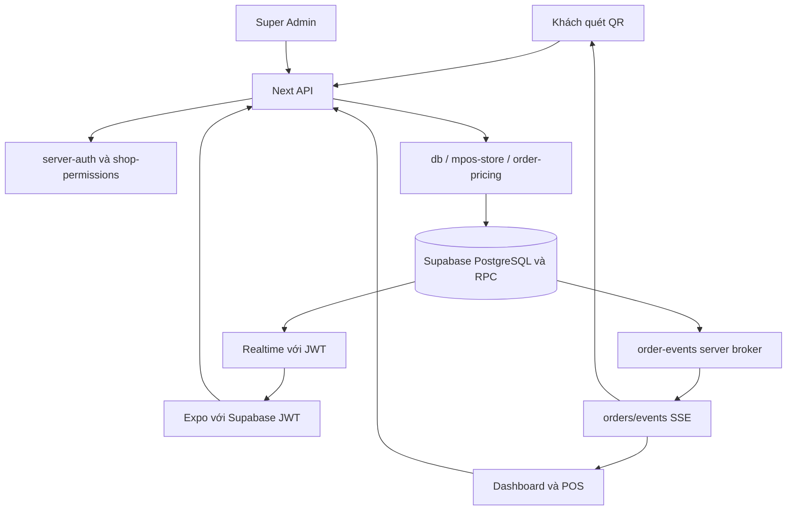

# Kiến trúc Qlaok

Đối chiếu source trong workspace ngày **18/10/2026** qua CodeGraph. Không khẳng định trạng thái production. Bắt đầu với [README](README.md) và [quy trình CodeGraph bắt buộc](docs/CODEGRAPH_WORKFLOW.md).

## Các ứng dụng và công nghệ

| Phần | Vị trí | Trách nhiệm |
| --- | --- | --- |
| Web Next.js 15 / React 19 / TypeScript | `src/app`, `src/components` | Marketing, auth, merchant dashboard, storefront, Super Admin |
| Backend App Router | `src/app/api` | Xác thực, quyền, catalog, đơn, pricing, thanh toán, AI, upload |
| Mobile Expo SDK 52 / React 18 / RN 0.76 | `mobile/App.tsx`, `mobile/src` | Đăng nhập, chọn shop, vận hành theo membership |
| Supabase | `supabase/migrations` | PostgreSQL, Auth, RLS, RPC atomic, Realtime |
| Tích hợp | `src/lib/gemini.ts`, `r2.ts` | Gateway AI text/vision, OCR và ảnh |
| Kiểm tra/triển khai | `tests`, `mobile/tests`, `.github/workflows`, `scripts` | Regression cô lập, fixtures, migration và deploy |

Các version trên là dòng dependency trong manifest, không phải khẳng định patch đang chạy trên VPS. Web và mobile có dependency tree/lockfile riêng; không dùng provider React web cho mobile.

## Bản đồ route

| Route | Phần triển khai/chức năng |
| --- | --- |
| `/`, `/pricing`, `/explore` | Marketing, plan copy và danh bạ |
| `/login`, `/onboarding` | Auth và tạo shop |
| `/s/[slug]`, `/s/[slug]/menu` | QR Cửa, QR Bàn và menu theo ngành |
| `/dashboard` | Tổng quan doanh thu và tồn kho |
| `/dashboard/orders` | POS, đơn, thanh toán và in |
| `/dashboard/catalog`, `/posts`, `/settings` | Nội dung và cấu hình shop |
| `/dashboard/reports`, `/billing` | Báo cáo và gói SaaS |
| `/dashboard/ai-scanner`, `/qr-studio` | OCR/import và xuất QR |
| `/admin` | Quản trị toàn hệ thống |

Các đường `/posts`, `/settings` trong bảng là hậu tố của `/dashboard`, không phải route root.

API hiện có: `/api/auth`, `/admin`, `/shops`, `/tables`, `/catalog`, `/posts`, `/orders`, `/orders/events`, `/service-requests`, `/push-tokens`, `/analytics/track`, `/ai/translate`, `/ai/ocr-menu`, `/upload`, `/webhooks/payment`, `/health` (các hậu tố sau mục đầu đều dưới `/api`). Không có `/api/items`; tài liệu cũ từng liệt kê route này sai với cây source hiện tại.

`/api/ai/translate` và `/api/ai/ocr-menu` yêu cầu phiên đăng nhập (`requireAuthenticatedUser`) và giới hạn tần suất in-memory theo user (translate 30 req/10 phút, OCR 10 req/10 phút → 429). OCR thật (không phải `useDemo`) chỉ cho gói có `allowAiOcr` (Premium) hoặc Super Admin, trả `403 PLAN_FEATURE_LOCKED`. `/api/webhooks/payment` không có secret mặc định: thiếu `PAYMENT_WEBHOOK_SECRET` thì mọi webhook từ nhà cung cấp bị từ chối (503); `action=create_order` yêu cầu chủ quán/profile owner hoặc Super Admin đã xác thực (thu ngân/nhân viên bị từ chối 403, chỉ Super Admin được chỉ định `ownerId` khác).

## Bảng dữ liệu và file báo cáo

Bảng dữ liệu web dùng `react-data-table-component` qua `src/components/ui/AppDataTable.tsx`; React Native không dùng thư viện React DOM này. CSV và workbook XLSX được tạo ở `src/lib/table-export.ts`, XLSX dùng ExcelJS tải theo nhu cầu. UI và export báo cáo dùng cùng dữ liệu đã lọc/sắp xếp, phân biệt phạm vi toàn bộ kết quả và trang hiện tại. Chart hiện tại vẫn là SVG/CSS tự vẽ (web) và View/Text (mobile). Xem [quy ước bảng/export](docs/DATA_TABLES_AND_EXPORT.md).

## Contracts và tầng core

| Module | Nhiệm vụ và lưu ý |
| --- | --- |
| `src/types/qlaok.ts` | Contracts locale, catalog, đơn, membership, shop theme, payment |
| `src/lib/db.ts` | Supabase client, CRUD shop/catalog/posts, analytics, billing và seed (chỉ tự seed dữ liệu demo ở môi trường non-production; trên `NODE_ENV=production` khi `public.shops` rỗng trả `{ ready: true, seeded: false }` mà không tự ghi demo shop) |
| `src/lib/mpos-store.ts` | Orders, stock, giá canonical, transition, bill theo bàn/session và bộ đếm in |
| `src/lib/shop-tables.ts` | Store bàn, kiểm tra bàn cùng quán/đang hoạt động, owner mutation và public DTO |
| `src/lib/service-requests.ts` | Yêu cầu phục vụ tại bàn (`call_staff`, `request_bill`) xác thực chữ ký QR bàn, chống spam lặp theo bàn/loại và chuyển trạng thái `pending → acknowledged → resolved` |
| `src/lib/table-helpers.ts` | Helper client-safe: URL QR, resolve lựa chọn, lọc bàn và thống kê theo ID |
| `src/lib/order-pricing.ts` | Công thức pricing dùng chung; không nhận tổng client làm nguồn quyết định |
| `src/lib/server-auth.ts` | Kiểm phiên HMAC hoặc Supabase JWT, auth guards, kiểm quyền shop và admin |
| `src/lib/shop-permissions.ts` | Membership và quyền theo shop; không dùng local để khôi phục quyền đã revoke |
| `src/lib/auth-session.ts`, `auth-credentials.ts` | Phiên web/legacy credentials, khởi tạo admin khi được cấu hình |
| `src/lib/dashboard-context.tsx` | Session, shop đang chọn và membership phía dashboard |
| `src/lib/order-events.ts` | Broker một upstream privileged subscription cho SSE đã được cấp quyền |
| `src/lib/order-live-sync.ts` | Fetch SSE, refresh, debounce, fallback và lifecycle trên web |
| `src/lib/order-chime.ts` | Cấu hình và phát âm báo đơn |
| `src/lib/push-notifications.ts` | Lưu/xóa Expo push token theo user + shop (`orders.view`), gửi push VI/EN cho chủ quán và nhân sự `orders.view` khi có đơn QR khách mới (chống lặp theo replay đơn/in-memory sau khi có ticket `ok`, chỉ đếm ticket `status === 'ok'` và tự dọn token `DeviceNotRegistered`); mobile hủy token best-effort trước `signOut` cả khi đăng xuất và khi gặp HTTP 401 (không lặp 401 đệ quy, không chặn xóa phiên local nếu token đã hết hạn) |
| `src/lib/payment-qr.ts` | Cấu hình/URL QR thanh toán merchant |
| `src/lib/plan-limits.ts`, `plan-copy.ts` | Quota/feature/giá hiển thị; billing server vẫn định giá độc lập |
| `src/lib/app-i18n.ts`, `i18n-helper.ts` | Miền ngôn ngữ quản trị và miền nội dung khách |

CodeGraph trả source và quan hệ để định vị, không chứng minh mọi dependency đã resolve. Đặc biệt kết quả “no dependents/no covering tests” không phải kết luận không có caller/test.

## Luồng nghiệp vụ đơn hàng

1. Guest gửi cart từ `ShowToStaffModal`; POS gửi từ workspace thu ngân. API phân biệt guest và staff, kiểm quyền cho hành động có đặc quyền.
2. Engine tải catalog của shop, kiểm item/options, tính giá và tổng giảm giá ở server, kiểm tồn theo nhu cầu cộng dồn. Không tin giá client hoặc ID của shop khác.
3. Khi DB được cấu hình, RPC/commit và schema migration chịu trách nhiệm tính nguyên tử, stock và chống replay. Không báo thành công nếu commit lỗi.
4. Fulfillment `new → preparing → completed` và `cancelled` tách khỏi `unpaid/paid/refunded`. Đã phục vụ không tự có nghĩa đã nhận tiền; thu, hoàn, hủy, restock phải theo transition/quyền riêng.
5. Bill theo table/session có thể gồm nhiều đơn. Payment idempotency không được áp lại vào lượt gọi món tiếp theo. Client gửi expected total để phát hiện số tiền đã thay đổi.
6. In bếp/tạm tính/biên nhận có counter riêng. Web ghi nhận yêu cầu in qua browser; mobile preview không được giả lập thành công in phần cứng.

Báo cáo doanh thu/tồn kho ở `computeShopRevenueAndInventoryStats` và `dbComputeShopRevenueAndInventoryStats` (ưu tiên RPC `public.get_shop_order_stats_summary` ở migration 010, kèm fallback phân trang `.range()` 1000 dòng/trang khi môi trường test không bật RPC); thời gian kế toán dùng UTC+7, không bị cắt ở ngưỡng 1000 dòng của PostgREST `.select('*')`, và tab Tổng quan Mobile đọc trực tiếp `stats` từ server thay vì tự cộng lại trên danh sách `orders` giới hạn 1000 dòng. Không suy doanh thu từ sự kiện “đưa nhân viên xem”.

## Xác thực và ranh giới dữ liệu

- `verifyRequestUser` hỗ trợ phiên Qlaok HMAC và xác minh Supabase JWT qua Auth; UI không là ranh giới quyền.
- `requireShopPermission` kiểm user, shop và active membership, rồi kiểm quyền. Owner/cashier/staff là vai trò theo shop; không chỉ dựa vào nhãn role trong client.
- Super Admin cần `requireSuperAdmin`; truy cập DB quản trị cần backend service-role hợp lệ. Mật khẩu khởi tạo chỉ seed khi `INITIAL_SUPER_ADMIN_PASSWORD` được cung cấp, không dùng mật khẩu mẫu trong tài liệu cũ.
- DB client privileged là server-only. RLS và việc revoke RPC cho public/anon/authenticated bảo vệ truy cập trực tiếp; API vẫn phải kiểm quyền vì service-role có đặc quyền.
- Khi orders dùng DB, `loadMergedOrders` trả canonical DB rows và lỗi thì throw; không ghép local orders. `.local-db` tồn tại cho legacy/dev, không bảo đảm hoạt động offline hoặc an toàn multi-process.
- Một số read gọi `ensureSupabaseReadyAndSeeded`; `/api/health` có thể seed nếu DB trống, và trạng thái HTTP không đủ kết luận DB ready.

## Realtime

Web dùng fetch SSE để gửi header auth. Merchant stream theo shop có `orders.view`; guest stream theo order có token riêng ở `x-tracking-token`. Broker server dùng backend key đăng ký Postgres Changes, phát event tối thiểu để client gọi API canonical; không gửi dữ liệu khách/thanh toán trong event.

Heartbeat giữ socket, không scan DB. Quyền được tái kiểm định kỳ; stream có lifetime hữu hạn, queue bounded và cleanup. Kết nối upstream thật mới được báo ready. Khi lỗi, client fallback 30 giây; hidden tab ngắt kết nối. Đổi shop loại response cũ, đổi ngôn ngữ không dựng lại subscription. Xem [REALTIME_NOTES](REALTIME_NOTES.md).

Mobile `useShopRealtimeOrders` dùng Supabase JWT đăng ký trực tiếp theo shop, debounce 200ms, canonical reload qua API, fallback 30 giây khi mất subscription/HTTP sync lỗi và dừng khi background. Không dùng HMAC web cho đường này.

## Hai miền ngôn ngữ

- Storefront/catalog: `vi/en/ko/ja/zh/es/it/ru`, chịu quota gói và `shop.supported_langs`, preference `qlaok_lang`.
- Web app/marketing/auth/admin: VI/EN, `AppI18nProvider`, preference `qlaok_app_locale`. Nội dung merchant giữ nguyên nếu chưa có bản dịch.
- Mobile dùng `MobileI18nProvider` và resource riêng; native lưu SecureStore, web localStorage. Đổi locale không được reset draft, fetch lại dữ liệu khởi tạo hay làm lặp chuông.

Chi tiết: [I18N_NOTES](I18N_NOTES.md). Gói Free/Basic/Premium hiện có maxLangs 1/3/8; không dùng bảng 5 ngôn ngữ cũ.

## Schema và rollout

Migration theo thứ tự README: 001 nền tảng; 002 orders/stock; 002z archive/reconcile bank refs legacy; 003 RLS và atomic mPOS; 004 memberships/billing/payments/audit; 005 order commit; 006 orders realtime publication; 007 shop_tables, orders.table_id và mở rộng RPC để giữ định danh bàn; 008 mobile_push_tokens lưu Expo push token với RLS server-only; 009 table_service_requests lưu yêu cầu phục vụ/xin hóa đơn tại bàn với RLS cho nhân sự `orders.view`, trigger chặn client mutate trực tiếp và thêm vào publication `supabase_realtime`; 010 shop_order_stats_summary thêm index tổng hợp và RPC `public.get_shop_order_stats_summary` (chỉ server thực thi) tính doanh thu/số lượng đơn toàn lịch sử và cửa sổ 7 ngày theo giờ Việt Nam (`UTC+7`).

Đọc SQL trực tiếp vì SQL không nằm trong graph hiện tại. Chạy `test:sql` trên PGlite để kiểm migration/RLS mà không sửa DB thật. Chuyển từ legacy local orders cần backup/đối chiếu dữ liệu; archive bank-ref không tự xác nhận giao dịch đúng/sai.

CI verify → migrate → deploy đúng SHA, sau restart kiểm subscription thật bằng `scripts/check-order-realtime.mjs`. Chỉ chạy probe đó khi được phép truy cập backend đích. Tài liệu này không khẳng định deployment đã thành công.

## Những giới hạn cần giữ khi làm task tiếp

- Tổng hợp doanh thu/số lượng đơn của `GET /api/orders`, `dbGetShopAnalyticsSummary` và Mobile Overview đã dùng RPC SQL `get_shop_order_stats_summary` (kèm fallback phân trang `.range()`), còn danh sách `orders` trả về trong `GET /api/orders` giữ giới hạn 1000 đơn gần nhất; các màn hình chi tiết lịch sử sâu hơn 1000 đơn trong một bảng cần bộ lọc/phân trang riêng khi dữ liệu tăng.
- Thay đổi catalog độc lập chưa có luồng stream riêng; entry/manual refresh vẫn cần thiết.
- Payment ledger/audit transaction hoàn chỉnh cho chốt ca chưa xong; không mô tả là hệ thống kế toán hoàn chỉnh.
- Chưa chứng minh máy in, iOS/Android thật và đối soát ngân hàng qua test local.
- `npm run lint` cần chỉnh toolchain riêng; hiện không phải gate đã kiểm chứng.

## Quản lý bàn, QR và báo cáo (18/10/2026)

`/dashboard/qr-studio` chứa `ShopTableManager`; owner/admin tạo, đổi tên/mã, khu vực, sức chứa, bật/tắt và archive/restore bàn. API `/api/tables` chỉ cho owner/admin mutate; public chỉ lấy bàn hoạt động của quán đã publish. Không có hard-delete qua API. Bàn có lịch sử được DB bảo vệ khỏi xóa.

QR bàn dùng `buildTableMenuUrl`: `/s/{slug}/menu?src=table&tableId={id}`. Storefront resolve ID trước, hỗ trợ `?table=` legacy theo tên/mã; link sai hoặc bàn ngừng hoạt động yêu cầu khách chọn lại rõ ràng. ID gửi tới orders API được kiểm tra cùng shop và còn hoạt động trước khi trừ kho; label do server lấy từ bàn. Client legacy không có ID vẫn có thể có nhãn lịch sử riêng.

`orders.table_id` giữ định danh; `table_label` giữ snapshot. Đổi tên/archive không đổi label đơn cũ hoặc chặn thanh toán đơn đang mở. Bill preview và settlement cho bàn quản lý cùng lọc theo ID; không ghép đơn legacy hoặc bàn cũ trùng tên vào bàn mới. Migration 007 giữ signature và semantics stock/payment/idempotency của RPC 005.

Reports có tab Theo bàn, lấy `summarizeOrdersByTable(filteredOrders, shopId, tables)`. Ngày, trạng thái, phương thức thanh toán, source và tìm kiếm áp dụng trước khi tổng hợp. Paid không hủy là doanh thu đã thu; unpaid/refunded/cancelled có số riêng. Rename/archive gộp theo ID, còn Mang về và legacy tách nhóm. Mobile tiếp tục đọc được order label cũ; giao diện quản lý bàn mới nằm trên web.

Theme mặc định light, đồng bộ preference `qlaok_theme` toàn app; đổi qua nút theme hoặc dùng system preference khi control bật tùy chọn đó. Modal xác nhận/tracker/payment dùng cùng light/dark variants; khung QR in vẫn trắng để đảm bảo tương phản. Menu chỉ giữ một dropdown ngôn ngữ compact, sidebar chỉ giữ một mũi tên collapse; thanh admin đen đã bỏ và thao tác thoát xem thay nằm trong navigation.
