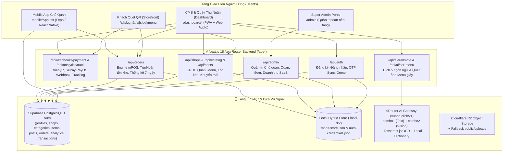

# 📘 TÀI LIỆU KIẾN TRÚC & ĐẶC TẢ CHI TIẾT CODEBASE: QLAOK ("QUÉT LÀ OK")

> **Cập nhật lần cuối:** `git commit 72ffb0e` (Nhánh `main`)  
> **Trạng thái CodeGraph Index:** `73 files` | `1,072 nodes` | `2,617 edges` (`[OK] Index is up to date`)  
> **Domain Production:** `https://qlaok.vunph.click` (VPS `43.128.116.69`, PM2 process `qlaok` port `3005`)

---

## 1. Tổng Quan Dự Án & Mô Hình Kinh Doanh

**Qlaok ("Quét Là OK")** là nền tảng **B2B2C Micro-SaaS kết hợp Cổng Khám Phá Địa Điểm (Local Directory) & Hệ thống mPOS Gọi Món Tại Bàn Realtime** dành cho các cửa hàng tại **34 Tỉnh / Thành phố Việt Nam** (theo danh mục hành chính mới sau sáp nhập).

### 1.1. Ba Ngành Nghề Mục Tiêu (`BusinessVertical`)
1. **Ẩm thực & Đồ uống (`fnb`):** Quán ăn, nhà hàng, cà phê, trà sữa, quán nhậu, xe đẩy đường phố.
2. **Dịch vụ & Chăm sóc (`service`):** Tiệm Nail, Spa, Gội đầu dưỡng sinh, Massage, Salon tóc, Studio, Phòng Gym, Giặt sấy.
3. **Bán lẻ & Đặc sản (`retail`):** Cửa hàng đặc sản địa phương, quà lưu niệm, shop thời trang, tạp hóa, nhà thuốc.

### 1.2. Năm Ngôn Ngữ Hỗ Trợ Tự Động (`SupportedLocale`)
- Tiếng Việt (`vi`), Tiếng Anh (`en`), Tiếng Hàn (`ko`), Tiếng Nhật (`ja`), Tiếng Trung Giản Thể (`zh`).
- Tự động nhận diện ngôn ngữ thiết bị khách quét QR qua chuỗi ưu tiên: `?lang=` $\rightarrow$ `localStorage('qlaok_lang')` $\rightarrow$ `navigator.language` $\rightarrow$ lọc theo `shop.supported_langs` và giới hạn gói cước (`PlanTier`) $\rightarrow$ fallback `en` / `vi`.

### 1.3. Ba Gói Cước SaaS (`PlanTier`)
| Gói cước | Giá / tháng | Giới hạn món (`maxItems`) | Số ngôn ngữ (`maxLangs`) | AI Vision OCR | Tuỳ chỉnh Theme |
| :--- | :--- | :--- | :--- | :--- | :--- |
| **Free (`free`)** | `0đ` | Tối đa `5` món | `1` (`vi`) | ❌ Không | ❌ Không |
| **Basic (`basic`)** | `39.000đ` | Tối đa `25` món | `3` ngôn ngữ | ❌ Không | ✅ Có |
| **Premium (`premium`)** | `69.000đ` | Không giới hạn (`999,999`) | Đủ `5` ngôn ngữ | ✅ Mở khóa | ✅ Có |

---

## 2. Kiến Trúc Công Nghệ (Tech Stack)

- **Web Framework:** `Next.js 15.1.6` (App Router), `React 19.0.0`, `TypeScript 5.7.2` (Strict Mode).
- **UI & Styling:** `Tailwind CSS 3.4`, `lucide-react`, `framer-motion` (hiệu ứng Drawer & Modal), `qrcode.react` + `html-to-image` (xuất Standee QR A6 PNG 300DPI), `browser-image-compression` (nén ảnh `.webp` phía client).
- **Database & Auth:** `@supabase/supabase-js` & `@supabase/ssr` kết hợp cơ chế **Hybrid Local Persistence** tại `.local-db/` giúp hoạt động mượt mà ngay cả khi chưa chạy migration phụ hoặc mất kết nối tạm thời.
- **AI & OCR Engine:** Cổng **9Router OpenAI-compatible** (`https://vunph.click/v1`, model `combo1` cho dịch thuật và `combo2` cho Vision OCR) kết hợp **Tesseract.js (`vie+eng`)** và từ điển thông minh nội bộ (`VIET_DICTIONARY` + `parseRawOcrTextFallback`) đảm bảo luôn trả về JSON chuẩn 100%.
- **Mobile App:** `Expo SDK 52` + `React Native 0.76.6` (`mobile/App.tsx`), kết nối trực tiếp Supabase và REST API `/api/orders`.
- **CI/CD & Hạ tầng:**
  - `.github/workflows/deploy.yml`: Tự động SSH vào VPS (`43.128.116.69`), pull nhánh `main` tại `/var/www/qlaok.vunph.click`, chạy `npm ci && npm run build` và khởi động lại `pm2 restart qlaok` (port `3005`).
  - `.github/workflows/supabase-migrate.yml` & `scripts/migrate-supabase.mjs`: Tự động chạy các file SQL trong `supabase/migrations/` qua Supabase Management API.

---

## 3. Cấu Trúc Thư Mục & Giải Thích Chi Tiết Từng Module

### 3.1. Định nghĩa Types (`src/types/qlaok.ts`)
Chứa toàn bộ hợp đồng dữ liệu (TypeScript Interfaces) dùng chung cho cả Frontend và Backend:
- `SupportedLocale` (`'vi' | 'en' | 'ko' | 'ja' | 'zh'`), `PlanTier` (`'free' | 'basic' | 'premium'`), `BusinessVertical` (`'fnb' | 'service' | 'retail'`).
- `Profile`: Thông tin chủ quán (`id`, `email`, `phone`, `full_name`, `plan`, `plan_expires_at`, `is_admin`, `role`).
- `Shop`: Cấu hình cửa hàng (`slug`, `vertical`, `tagline_i18n`, `description_i18n`, `wifi_info`, `opening_hours`, `supported_langs`, `theme_config`, `is_published`, ...).
- `Category` & `CatalogItem`: Danh mục và Món ăn/Dịch vụ/Sản phẩm (hỗ trợ `price`, `compare_at_price`, `duration_mins`, `options_json`, `stock_quantity`, `sold_count`, `view_count`).
- `ShopOrder` & `OrderLineItem`: Đơn hàng mPOS (`order_code`, `table_label`, `visitor_lang`, `status`: `'new' | 'preparing' | 'completed' | 'cancelled'`, `payment_method`: `'cash' | 'vietqr'`, `payment_status`: `'unpaid' | 'paid'`, `source`: `'qr_table' | 'counter_pos'`).
- `Post`, `AnalyticsEvent`, `PaymentTransaction`, `CartSelection`.

### 3.2. Tầng Core Library (`src/lib/`)
| File | Chức năng & Logic cốt lõi |
| :--- | :--- |
| [`src/lib/db.ts`](file:///e:/Projects/qlaok/src/lib/db.ts) | Tầng truy xuất Supabase chính (`getSupabaseDbClient`). Hàm `ensureSupabaseReadyAndSeeded()` tự động kiểm tra và nạp dữ liệu mẫu (3 cửa hàng `pho-hoi-an`, `linh-spa-nail`, `dac-san-mien-trung`) nếu DB trống. Cung cấp các hàm CRUD cho `shops`, `categories`, `items`, `posts`, `analytics_events`, và `payment_transactions`. |
| [`src/lib/mpos-store.ts`](file:///e:/Projects/qlaok/src/lib/mpos-store.ts) | Engine xử lý đơn hàng mPOS và tồn kho. Lưu trữ đồng bộ tại `.local-db/mpos-store.json` và bảng `public.orders` / `public.items` trên Supabase. Tự động kiểm tra tồn kho khi tạo đơn (`dbCreateOrder`), trừ `stock_quantity`, tăng `sold_count`, tự động khóa món (`is_available = false`) khi `stock_quantity === 0`, và **hoàn lại tồn kho tự động** khi hủy đơn (`dbUpdateOrderStatus` $\rightarrow$ `cancelled`). Tính toán báo cáo doanh thu 7 ngày (`computeShopRevenueAndInventoryStats`). |
| [`src/lib/auth-session.ts`](file:///e:/Projects/qlaok/src/lib/auth-session.ts) | Quản lý phiên đăng nhập trên trình duyệt (`localStorage`: `qlaok_auth_owner_v1`, `qlaok_active_shop_id`, `qlaok_admin_backup_v1`). Định nghĩa tài khoản Super Admin tối cao (`SUPER_ADMIN_EMAIL = 'hoangvu96z@gmail.com'`, `SUPER_ADMIN_ID = 'admin-hoangvu96z'`). Hỗ trợ tính năng **Admin Impersonation** (`startAdminImpersonation` / `stopAdminImpersonation`) cho phép Super Admin vào thẳng Dashboard của bất kỳ chủ quán nào để hỗ trợ kỹ thuật rồi quay lại trang `/admin` chỉ với 1 chạm. |
| [`src/lib/auth-credentials.ts`](file:///e:/Projects/qlaok/src/lib/auth-credentials.ts) | Quản lý băm mật khẩu (`SHA-256` kèm salt `qlaok-salt-v1:`) tại `.local-db/auth-credentials.json` kết hợp bảng `public.profiles` trên Supabase. Hàm `ensureSuperAdminSeeded()` tự động khởi tạo tài khoản Super Admin (`hoangvu96z@gmail.com` / mật khẩu mặc định `Hoangvu@6496`, gói `premium` đến năm 2030). |
| [`src/lib/dashboard-context.tsx`](file:///e:/Projects/qlaok/src/lib/dashboard-context.tsx) | React Context (`DashboardProvider` & `useDashboard()`) quản lý danh sách quán của chủ quán đang đăng nhập, quán đang chọn (`activeShop`), đồng bộ phiên Supabase Auth OTP/Magic Link qua `/api/auth` (`action: 'sync_user'`), và tự động điều hướng `/login` (nếu chưa đăng nhập) hoặc `/onboarding` (nếu chủ quán mới chưa có cửa hàng nào). |
| [`src/lib/gemini.ts`](file:///e:/Projects/qlaok/src/lib/gemini.ts) | Client gọi **9Router AI** (`call9RouterJson` hỗ trợ cả JSON thường và Server-Sent Events `data:` stream). Kèm theo từ điển ẩm thực/dịch vụ Việt Nam (`VIET_DICTIONARY`), bộ dịch thông minh dự phòng (`smartFallbackTranslate`), và bộ phân tích văn bản OCR bằng Regex (`parseRawOcrTextFallback`) giúp quy đổi các định dạng giá `35k`, `35.000`, `35` về số nguyên VNĐ `35000`. |
| [`src/lib/i18n-helper.ts`](file:///e:/Projects/qlaok/src/lib/i18n-helper.ts) | Chứa `LOCALE_META`, `detectVisitorLocale()`, `tField()`, `formatCurrency()`, `checkShopOpenStatus()` (tự động tính trạng thái Đang mở/Đã đóng cửa theo giờ thực tế trong tuần), từ điển giao diện 5 ngôn ngữ (`UI_LABELS`), và danh sách ghi chú nhanh theo từng ngành (`QUICK_TAGS_BY_VERTICAL`). |
| [`src/lib/plan-limits.ts`](file:///e:/Projects/qlaok/src/lib/plan-limits.ts) | Định nghĩa cấu hình 3 gói cước (`PLAN_CONFIGS`), hàm kiểm tra giới hạn số món (`canAddMoreItems`) và giới hạn số ngôn ngữ hiển thị (`getAllowedLocalesForPlan`). |
| [`src/lib/vietnam-provinces.ts`](file:///e:/Projects/qlaok/src/lib/vietnam-provinces.ts) | Danh sách chuẩn **34 Tỉnh / Thành phố trực thuộc Trung ương** của Việt Nam (6 Thành phố trực thuộc TW & 28 Tỉnh, chia theo 3 miền `Bắc Bộ`, `Trung Bộ & Tây Nguyên`, `Nam Bộ`, kèm chú thích các tỉnh sáp nhập `mergedNote`) và hàm chuẩn hóa tên thành phố (`normalizeToProvince34`). |
| [`src/lib/r2.ts`](file:///e:/Projects/qlaok/src/lib/r2.ts) | Tích hợp Cloudflare R2 qua AWS S3 SDK (`createR2PresignedUploadUrl`). |
| [`src/lib/seed-data.ts`](file:///e:/Projects/qlaok/src/lib/seed-data.ts) | Dữ liệu mẫu chuẩn 5 ngôn ngữ cho 3 cửa hàng mẫu (`shop-fnb-001` / `pho-hoi-an`, `shop-service-002` / `linh-spa-nail`, `shop-retail-003` / `dac-san-mien-trung`), 9 danh mục, 11 sản phẩm/dịch vụ, bài viết khuyến mãi và sự kiện thống kê mẫu. |

---

### 3.3. Hệ Thống Backend API Routes (`src/app/api/`)

| Endpoint | Methods | Mô tả chi tiết |
| :--- | :--- | :--- |
| [`/api/auth`](file:///e:/Projects/qlaok/src/app/api/auth/route.ts) | `POST` | Xử lý 4 hành động (`action`): 1. `demo_login`: Đăng nhập nhanh tài khoản mẫu (`chuquan@qlaok.vn` / `qlaok123456`). 2. `register`: Đăng ký tài khoản chủ quán mới trên Supabase `profiles` + lưu mật khẩu băm (nếu trùng email Super Admin thì cập nhật mật khẩu/thông tin Super Admin). 3. `login`: Xác thực bằng mật khẩu băm hoặc Supabase Auth, trả về `user`, danh sách `shops` của chủ quán và cờ `isAdmin`. 4. `sync_user`: Đồng bộ tài khoản đăng nhập qua OTP/Magic Link vào bảng `profiles`. |
| [`/api/admin`](file:///e:/Projects/qlaok/src/app/api/admin/route.ts) | `GET`, `POST` | **API Quản trị tối cao dành riêng cho Super Admin (`hoangvu96z@gmail.com`)** (kiểm tra qua header `x-admin-email`, query `adminEmail` hoặc body `adminEmail`): - `GET`: Trả về toàn bộ KPIs hệ thống (tổng chủ quán, MRR ước tính, doanh thu SaaS thực thu, tổng GMV mPOS toàn sàn, phân bổ gói cước/ngành nghề/ngôn ngữ, danh sách chủ quán, cửa hàng, đơn hàng mPOS, giao dịch VietQR, món sắp hết hàng và `systemHealth`). - `POST`: Hỗ trợ 9 tác vụ quản trị: `update_owner_plan`, `create_owner`, `reset_owner_password`, `delete_owner`, `update_shop` (ẩn/hiện quán, đổi thông tin), `delete_shop`, `approve_transaction` (duyệt lệnh nâng cấp gói VietQR), `update_order_status`, `reseed_demo_data`. |
| [`/api/shops`](file:///e:/Projects/qlaok/src/app/api/shops/route.ts) | `GET`, `POST`, `PATCH` | - `GET ?slug=...`: Lấy trọn gói dữ liệu Storefront (`shop`, `categories`, `items` đã gộp tồn kho, `posts`, `ownerPlan`). - `GET ?ownerId=...`: Lấy danh sách cửa hàng và hồ sơ của chủ quán. - `POST`: Tạo cửa hàng mới (tự động chuẩn hóa `slug` và chống trùng lặp). - `PATCH`: Cập nhật cấu hình cửa hàng (giờ mở cửa, Wi-Fi, ngôn ngữ, theme, địa chỉ...). |
| [`/api/catalog`](file:///e:/Projects/qlaok/src/app/api/catalog/route.ts) | `GET`, `POST`, `DELETE` | Quản lý danh mục & món ăn/dịch vụ: - `GET ?shopId=...`: Lấy toàn bộ danh mục và món ăn kèm tồn kho. - `POST`: Hỗ trợ `action: 'upsert_category'`, `'upsert_item'` (kiểm tra giới hạn gói cước và cập nhật `stock_quantity`), và `'bulk_import'` (lưu hàng loạt từ AI Vision Scanner). - `DELETE`: Xóa món (`?itemId=...`) hoặc danh mục (`?categoryId=...`). |
| [`/api/orders`](file:///e:/Projects/qlaok/src/app/api/orders/route.ts) | `GET`, `POST`, `PATCH` | Engine đơn hàng mPOS: - `GET ?shopId=...` hoặc `?orderId=...`: Lấy danh sách đơn hàng của quán kèm thống kê doanh thu 7 ngày và tồn kho; hoặc lấy chi tiết 1 đơn để khách theo dõi Realtime. - `POST`: Khách gửi đơn từ bàn (`qr_table`) hoặc thu ngân tạo đơn tại quầy (`counter_pos`), tự động kiểm tra & trừ tồn kho, ghi nhận sự kiện `show_to_staff`. - `PATCH`: Cập nhật trạng thái đơn (`new` $\rightarrow$ `preparing` $\rightarrow$ `completed` / `cancelled`) và trạng thái thanh toán (`unpaid` / `paid`). |
| [`/api/posts`](file:///e:/Projects/qlaok/src/app/api/posts/route.ts) | `GET`, `POST`, `DELETE` | CRUD bài viết khuyến mãi / thông báo của quán hiển thị trên trang QR Cửa. |
| [`/api/ai/translate`](file:///e:/Projects/qlaok/src/app/api/ai/translate/route.ts) | `POST` | Dịch tự động tên danh mục, tên món và mô tả từ Tiếng Việt sang 5 ngôn ngữ (`vi`, `en`, `ko`, `ja`, `zh`) theo ngữ cảnh ngành nghề (`fnb` / `service` / `retail`) qua 9Router (`combo1`) hoặc từ điển thông minh nội bộ. |
| [`/api/ai/ocr-menu`](file:///e:/Projects/qlaok/src/app/api/ai/ocr-menu/route.ts) | `POST` | Nhận ảnh chụp menu (`imageBase64`) hoặc văn bản OCR (`rawOcrText`), chạy **Tesseract.js (`vie+eng`)** kết hợp **9Router Vision (`combo2`)** (hoặc `parseRawOcrTextFallback`) để bóc tách thành cấu trúc `categories` $\rightarrow$ `items` kèm giá tiền VNĐ và bản dịch 5 ngôn ngữ. |
| [`/api/analytics/track`](file:///e:/Projects/qlaok/src/app/api/analytics/track/route.ts) | `GET`, `POST` | Ghi nhận sự kiện (`scan_door`, `scan_table`, `item_view`, `show_to_staff`, `wifi_copy`) và trả về báo cáo tổng hợp cho Dashboard chủ quán. |
| [`/api/webhooks/payment`](file:///e:/Projects/qlaok/src/app/api/webhooks/payment/route.ts) | `GET`, `POST` | Tạo mã giao dịch nâng cấp gói (`QLAOKB...` / `QLAOKP...`), nhận Webhook biến động số dư từ SePay/PayOS để tự động nâng cấp gói cước 30 ngày cho chủ quán. |
| [`/api/upload`](file:///e:/Projects/qlaok/src/app/api/upload/route.ts) | `POST` | Sinh Presigned URL upload ảnh lên Cloudflare R2 hoặc lưu trực tiếp vào `public/uploads/` khi chạy local. |
| [`/api/health`](file:///e:/Projects/qlaok/src/app/api/health/route.ts) | `GET` | Kiểm tra sức khỏe toàn hệ thống (trạng thái Supabase, số lượng bản ghi các bảng, cấu hình R2, cấu hình 9Router AI). |

---

### 3.4. Các Phân Hệ Giao Diện Web (`src/app/` & `src/components/`)

#### A. Phân hệ Khách hàng Quét Mã QR (`src/app/(storefront)/s/[slug]/`)
1. **Trang Micro-Website QR Cửa ([`src/app/(storefront)/s/[slug]/page.tsx`](file:///e:/Projects/qlaok/src/app/%28storefront%29/s/%5Bslug%5D/page.tsx)):**
   - Mở khi khách quét mã QR dán ở cửa (`?src=door`), tự động bắn sự kiện `scan_door`.
   - Hiển thị ảnh bìa, logo, tên quán, tagline đa ngôn ngữ, huy hiệu **Đang mở cửa / Đã đóng cửa** theo giờ thực tế.
   - Thẻ [`WifiBadge.tsx`](file:///e:/Projects/qlaok/src/components/storefront/WifiBadge.tsx) cho phép copy mật khẩu Wi-Fi 1 chạm (bắn sự kiện `wifi_copy`).
   - Nút mở Google Maps chỉ đường, nút đánh giá 5 sao Google Review, danh sách bài đăng khuyến mãi (`posts`), và nút CTA nổi bật dẫn vào trang Menu/Bảng giá.
2. **Trang Menu / Bảng Giá QR Bàn ([`src/app/(storefront)/s/[slug]/menu/page.tsx`](file:///e:/Projects/qlaok/src/app/%28storefront%29/s/%5Bslug%5D/menu/page.tsx)):**
   - Mở thẳng khi khách quét mã QR tại bàn (`?src=table`), tự động bắn sự kiện `scan_table`.
   - Thanh chuyển đổi ngôn ngữ 5 cờ quốc gia ([`LanguageSwitcher.tsx`](file:///e:/Projects/qlaok/src/components/storefront/LanguageSwitcher.tsx)), ô tìm kiếm đa ngôn ngữ và thanh trượt Danh mục dính ở đầu trang (Sticky Category Tabs).
   - Component [`VerticalRenderer.tsx`](file:///e:/Projects/qlaok/src/components/storefront/VerticalRenderer.tsx) tự động biến đổi giao diện theo 3 ngành:
     - `fnb`: Danh sách ngang kèm ảnh vuông `80x80px`, nhãn *Bán chạy*, cảnh báo tồn kho (`🔥 Còn X`) và nút `+` thêm nhanh.
     - `service`: Bảng giá thanh lịch có đường chấm nối (`......`) và thời lượng dịch vụ (`⏱ 60 phút`).
     - `retail`: Lưới sản phẩm 2 cột (`2-Column Grid`) tỷ lệ `1:1`.
   - Drawer chi tiết món ([`ItemDetailDrawer.tsx`](file:///e:/Projects/qlaok/src/components/storefront/ItemDetailDrawer.tsx)): Chọn số lượng, tùy chọn/topping (`options_json`), thẻ ghi chú nhanh (`QUICK_TAGS_BY_VERTICAL`) và ghi chú tự do.
   - Modal Gọi Món & Đưa Nhân Viên Xem ([`ShowToStaffModal.tsx`](file:///e:/Projects/qlaok/src/components/storefront/ShowToStaffModal.tsx)):
     - Hiển thị danh sách món đã chọn bằng **Tiếng Việt chữ lớn, độ tương phản cao** kèm ngôn ngữ của khách để nhân viên phục vụ đọc hiểu ngay lập tức.
     - Cho phép chọn bàn (`Bàn 01`, `Bàn 02`... hoặc `Mang về`), phương thức thanh toán (`Tiền mặt` / `VietQR`) và bấm **🚀 Gửi Đơn Xuống Quầy / Bếp Ngay**.
     - Sau khi gửi, hiển thị **Live Order Status Tracker** (tự động poll mỗi 2.5 giây) theo dõi trực tiếp 3 bước: *Chờ quầy xác nhận (`new`) $\rightarrow$ Đang chế biến (`preparing`) $\rightarrow$ Đã phục vụ & Hoàn tất (`completed`)*.

#### B. Phân hệ Quản trị Chủ quán & mPOS (`src/app/(dashboard)/dashboard/`)
1. **Layout & Chuông báo Realtime ([`src/app/(dashboard)/dashboard/layout.tsx`](file:///e:/Projects/qlaok/src/app/%28dashboard%29/dashboard/layout.tsx)):**
   - Hỗ trợ chuyển đổi giữa các cửa hàng của chủ quán hoặc thêm cửa hàng mới (`/onboarding`).
   - Nếu Super Admin đang ở chế độ **Impersonation** (*"Đang hỗ trợ Chủ quán"*), hiển thị thanh trạng thái nổi bật cho phép quay về `/admin` 1 chạm.
   - Lắng nghe `BroadcastChannel('qlaok_realtime_sync')` và poll `/api/orders` mỗi 3.5 giây: khi có đơn mới từ bàn, tự động phát **chuông báo âm thanh 2 nốt (Web Audio API)** + bật Toast thông báo nổi góc phải màn hình ở bất kỳ trang nào trong Dashboard.
2. **Tổng quan Doanh thu & Thống kê ([`src/app/(dashboard)/dashboard/page.tsx`](file:///e:/Projects/qlaok/src/app/%28dashboard%29/dashboard/page.tsx)):**
   - KPIs: Doanh thu hôm nay, Tổng doanh thu lũy kế, Giá trị trung bình/đơn (AOV), Lượt quét QR Cửa & QR Bàn.
   - Biểu đồ doanh thu 7 ngày gần nhất, Cảnh báo món sắp hết hàng (`stock_quantity <= 5`), Top món bán chạy nhất, và Biểu đồ tỷ lệ ngôn ngữ khách hàng (`VI`, `EN`, `KO`, `JA`, `ZH`).
3. **Màn hình Quầy Thu Ngân & Bếp mPOS ([`src/app/(dashboard)/dashboard/orders/page.tsx`](file:///e:/Projects/qlaok/src/app/%28dashboard%29/dashboard/orders/page.tsx)):**
   - Quản lý đơn hàng theo thời gian thực (`Đang xử lý`, `Mới`, `Đang làm`, `Hoàn tất`, `Đã hủy`).
   - Nút **Nhận đơn & Báo bếp**, **Đã phục vụ & Thu tiền**, bật **Mã VietQR động tự điền đúng số tiền của bàn**, hoặc **Tạo đơn nhanh tại quầy (Counter POS)**.
4. **Quản lý Thực đơn, Giá & Tồn kho ([`src/app/(dashboard)/dashboard/catalog/page.tsx`](file:///e:/Projects/qlaok/src/app/%28dashboard%29/dashboard/catalog/page.tsx)):**
   - Component [`QuickItemRow.tsx`](file:///e:/Projects/qlaok/src/components/dashboard/QuickItemRow.tsx): Gạt Switch **Còn hàng / Tạm hết** 1 chạm, sửa giá trực tiếp ngoài dòng, cộng/trừ nhanh tồn kho (`stock_quantity`) hoặc đặt không giới hạn (`∞`).
   - Component [`TranslationEditorModal.tsx`](file:///e:/Projects/qlaok/src/components/dashboard/TranslationEditorModal.tsx): Nhập Tiếng Việt $\rightarrow$ bấm **Dịch tự động bằng AI** sang 5 ngôn ngữ và chỉnh sửa từng ngôn ngữ trước khi lưu.
5. **AI Vision Menu Scanner ([`src/app/(dashboard)/dashboard/ai-scanner/page.tsx`](file:///e:/Projects/qlaok/src/app/%28dashboard%29/dashboard/ai-scanner/page.tsx)):**
   - Nén ảnh `.webp` phía client $\rightarrow$ trích xuất văn bản bằng Tesseract.js + phân tích cấu trúc bằng 9Router Vision AI $\rightarrow$ hiển thị bảng Preview cho phép chỉnh sửa tên/giá rồi bấm **Lưu toàn bộ vào cửa hàng**.
6. **QR Print Studio ([`src/app/(dashboard)/dashboard/qr-studio/page.tsx`](file:///e:/Projects/qlaok/src/app/%28dashboard%29/dashboard/qr-studio/page.tsx)):**
   - Sinh 2 mã QR chuyên biệt (**QR Dán Cửa** & **QR Đặt Bàn**), dựng mẫu Standee A6 ([`PrintableStandee.tsx`](file:///e:/Projects/qlaok/src/components/dashboard/PrintableStandee.tsx)) kèm Wi-Fi và câu mời quét 5 thứ tiếng, xuất file PNG chất lượng in ấn.
7. **Khuyến mãi (`/dashboard/posts`), Cài đặt quán (`/dashboard/settings` - chọn 34 Tỉnh/Thành phố, giờ mở cửa, Wi-Fi, màu chủ đạo) & Nâng cấp gói cước VietQR (`/dashboard/billing`).**

#### C. Phân hệ Super Admin Portal (`src/app/(admin)/admin/page.tsx`)
Trang quản trị toàn nền tảng dành riêng cho tài khoản Super Admin (`hoangvu96z@gmail.com` / mật khẩu mặc định `Hoangvu@6496`), gồm 6 phân khu (Tabs):
1. **`overview` (Tổng quan Toàn Sàn):** Theo dõi MRR ước tính, Doanh thu SaaS thực thu, Tổng GMV mPOS toàn hệ thống, tổng lượt quét QR, tỷ lệ ngôn ngữ khách quốc tế, cảnh báo tồn kho và nhật ký sự kiện thời gian thực.
2. **`owners` (Quản lý Chủ quán):** Tìm kiếm/lọc chủ quán theo gói cước, tạo tài khoản chủ quán mới, nâng/hạ gói cước (`Free` / `Basic` / `Premium`) kèm số ngày hiệu lực, đặt lại mật khẩu, xóa chủ quán, hoặc bấm **"Vào quyền Chủ quán" (Impersonate)** để hỗ trợ trực tiếp.
3. **`shops` (Quản lý Cửa hàng):** Xem toàn bộ cửa hàng trên nền tảng kèm GMV, số món, lượt quét QR; bật/tắt trạng thái hiển thị công khai (`is_published`), gán lại chủ sở hữu hoặc xóa cửa hàng.
4. **`orders` (Giám sát Đơn mPOS Toàn Sàn):** Xem và xử lý trạng thái mọi đơn hàng mPOS của tất cả cửa hàng theo thời gian thực.
5. **`billing` (Đối soát Thanh toán SaaS):** Xem lịch sử giao dịch nâng cấp gói qua VietQR và bấm **Duyệt thanh toán 1 chạm** (`approve_transaction`) cho các lệnh đang chờ (`pending`).
6. **`system` (Hạ tầng & Dữ liệu):** Kiểm tra kết nối Supabase, 9Router AI, Cloudflare R2, số lượng bản ghi từng bảng và nút **Đồng bộ lại 3 cửa hàng Demo mẫu (`reseed_demo_data`)**.

#### D. Phân hệ Marketing, Auth & Onboarding
- **Trang chủ ([`src/app/(marketing)/page.tsx`](file:///e:/Projects/qlaok/src/app/%28marketing%29/page.tsx)):** Hero section kèm **Interactive Live Demo** chuyển đổi trực tiếp giữa 3 ngành nghề và 5 ngôn ngữ ngay trên trang chủ.
- **Cổng Khám Phá 34 Tỉnh Thành ([`src/app/(marketing)/explore/page.tsx`](file:///e:/Projects/qlaok/src/app/%28marketing%29/explore/page.tsx)):** Tìm kiếm, lọc cửa hàng theo ngành nghề (`fnb`, `service`, `retail`) và 34 Tỉnh/Thành phố Việt Nam.
- **Bảng giá ([`src/app/(marketing)/pricing/page.tsx`](file:///e:/Projects/qlaok/src/app/%28marketing%29/pricing/page.tsx)):** So sánh chi tiết 3 gói `Free`, `Basic`, `Premium`.
- **Đăng nhập / Đăng ký ([`src/app/(auth)/login/page.tsx`](file:///e:/Projects/qlaok/src/app/%28auth%29/login/page.tsx)) & Onboarding 3 bước ([`src/app/(auth)/onboarding/page.tsx`](file:///e:/Projects/qlaok/src/app/%28auth%29/onboarding/page.tsx)):** Hỗ trợ Đăng nhập bằng Email/Mật khẩu, Đăng ký tài khoản Chủ quán mới, Đăng nhập bằng mã OTP Email (Supabase Auth), hoặc Mở nhanh tài khoản Demo.

---

### 3.5. Ứng Dụng Di Động Chủ Quán (`mobile/App.tsx`)
Xây dựng bằng **React Native + Expo (`mobile/`)**, gồm 4 Tab chuyên biệt cho chủ quán và thu ngân:
1. **`🔔 Đơn mPOS` (`orders`):** Poll đơn mới mỗi 3.5 giây từ `/api/orders`, tự động **rung điện thoại (`Vibration.vibrate`) + hiện Banner thông báo nổi** khi khách tại bàn gửi đơn; hỗ trợ lọc đơn (`Đang xử lý`, `Mới`, `Đang làm`, `Hoàn tất`) và bấm chuyển trạng thái / thu tiền 1 chạm.
2. **`📊 Tổng quan` (`overview`):** Xem doanh thu thực tế hôm nay, tổng doanh thu lũy kế, số món sắp hết hàng, lượt quét QR Cửa / QR Bàn và phân bố ngôn ngữ khách.
3. **`🍜 Thực đơn & Kho` (`catalog`):** Bật/tắt Switch Còn hàng/Tạm hết, chỉnh nhanh số lượng tồn kho (`-1`, `+5`, `∞`), thêm món mới nhanh trên điện thoại.
4. **`⚙️ Cài đặt` (`settings`):** Cập nhật tên quán, tỉnh/thành phố, số điện thoại, SSID & mật khẩu Wi-Fi.

---

## 4. Kiểm Thử Tự Động & Vận Hành

- **Kiểm tra kiểu dữ liệu TypeScript:** `npm run typecheck` (`tsc --noEmit`).
- **Unit Tests ([`tests/unit.test.ts`](file:///e:/Projects/qlaok/tests/unit.test.ts)):** `npm run test:unit` — Kiểm thử 7 nhóm nghiệp vụ cốt lõi:
  1. Danh mục 34 Tỉnh/Thành phố Việt Nam & hàm chuẩn hóa địa giới hành chính.
  2. Nhận diện ngôn ngữ `i18n-helper`, format tiền tệ & kiểm tra giờ đóng/mở cửa.
  3. Giới hạn gói cước `plan-limits` (`Free`, `Basic`, `Premium`).
  4. Bộ dịch thông minh & Regex bóc tách giá từ văn bản OCR (`35k` $\rightarrow$ `35000`).
  5. Cấu hình Cloudflare R2.
  6. Tính toàn vẹn của Seed Data 3 cửa hàng mẫu.
  7. Engine đơn hàng mPOS (`dbCreateOrder`, tự động trừ kho, khóa món khi hết hàng, hoàn kho khi hủy đơn, thống kê doanh thu 7 ngày).
- **End-to-End Tests ([`tests/e2e.test.mjs`](file:///e:/Projects/qlaok/tests/e2e.test.mjs)):** `npm run test:e2e` — Kiểm thử toàn diện các Route Handlers API và các trang giao diện.
